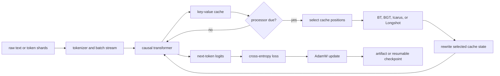

# Global Cache Workspace: theory, architecture, and file atlas

This document is the conceptual specification and repository map for Global Cache Workspace (GCW). It explains the research question, the mathematical objectives, the runtime data flow, the model variants, the checkpoint contract, the analysis methods, and the role of every tracked file. Keep implementation-level contracts in types and tests; keep the longer rationale here. When prose and executable behavior disagree, the source and tests define the current behavior, and this document needs correction.

Centralize theory, experiment rationale, cross-module data flow, and design tradeoffs here. Keep concise docstrings for public interfaces, tensor shapes, side effects, raised errors, and guarantees that a caller needs at the point of use. Keep local comments where code encodes a non-obvious invariant. Removing those local contracts would make one large document a single point of failure and force readers to context-switch during debugging.

## Contents

1. [The repository in one page](#the-repository-in-one-page)
2. [The research question](#the-research-question)
3. [The causal language-model baseline](#the-causal-language-model-baseline)
4. [The cache-processing mechanism](#the-cache-processing-mechanism)
5. [Model variants](#model-variants)
6. [JEPA from first principles](#jepa-from-first-principles)
7. [Why GCW is not a JEPA](#why-gcw-is-not-a-jepa)
8. [Data and tokenization](#data-and-tokenization)
9. [Training and exact continuation](#training-and-exact-continuation)
10. [Evaluation, conversion, and analysis](#evaluation-conversion-and-analysis)
11. [Operational invariants and sharp edges](#operational-invariants-and-sharp-edges)
12. [Complete file atlas](#complete-file-atlas)
13. [Primary references](#primary-references)

## The repository in one page

GCW asks whether a small learned module can reorganize a causal transformer's key-value cache and improve later prediction. The backbone remains a decoder-only language model. The new module periodically reads selected cached states, mixes information across time, layers, or cache heads, and writes transformed states back. Training still minimizes next-token cross-entropy.

The shortest accurate mental model is:

> A transformer writes a notebook while reading. GCW occasionally lets a small editor compress or cross-reference selected notebook entries before the transformer continues. The editor learns only from whether later token predictions improve.

The core execution path is:



Five boundaries prevent conceptual mistakes:

1. `TF` is the unprocessed causal-transformer baseline. `BT`, `BGT`, `Icarus`, and `Longshot` add cache processors.
2. The cache processor changes internal memory, not the training target. All variants learn through causal token loss.
3. A portable artifact checkpoint supports inference and publication. A version-2 training checkpoint additionally captures optimizer, cursor, and random state for continuation.
4. Evaluation uses native GCW models and tokenizers. Hugging Face and legacy checkpoints enter through explicit conversion.
5. The JEPA section below explains related representation-prediction theory. No current GCW path implements a JEPA objective.

### Repository layers

| Layer | Main paths | Responsibility |
|---|---|---|
| Configuration | `gcw/config.py`, `configs/` | Typed experiment definitions and concrete run matrices |
| Data | `gcw/data/` | Tokenization, FineWeb shards, SFT rows, resumable batch streams |
| Backbone | `gcw/models/transformer.py` | Decoder-only attention, MLP, RoPE, loss, and generation |
| Memory | `gcw/models/cache_state.py`, `windowed_cache.py` | Dynamic and static KV storage plus selection metadata |
| Processors | `bt.py`, `bgt.py`, `icarus.py`, `longshot.py` | Alternative ways to read and rewrite cached representations |
| Training | `gcw/train.py`, `training_checkpoint.py` | Distributed optimization, schedules, exact resume, W&B |
| Evaluation | `gcw/eval.py`, `eval_support.py`, `loss_eval.py` | Task generation, likelihood, BPB, distributed aggregation |
| Conversion | `gcw/convert.py`, `bottleneck_specs.py` | Strict translation from external checkpoint layouts |
| Analysis | `gcw/analysis/` | Head ablation, synergy, raw loss dumps, recurrent Longshot probes |
| Operations | `scripts/`, `docs/` | Slurm launch, reproduction, publication, and focused reports |
| Verification | `tests/` | Behavioral, numerical, distributed, configuration, and regression contracts |

## The research question

A standard autoregressive transformer preserves a key and value for every retained token at every layer. This gives later queries direct access to earlier states, but it has three limitations:

- memory grows linearly with context length;
- cached states remain mostly frozen after creation;
- cross-layer information only mixes through the normal forward stack, not through an explicit global memory workspace.

GCW studies a narrower intervention than replacing the transformer. It inserts a cache processor at a fixed cadence and asks:

> Can a comparatively small module improve future prediction by selecting and rewriting internal memory while preserving the pretrained backbone and its causal interface?

This framing creates clean comparisons:

- `TF` measures the backbone without cache rewriting;
- added-on-top configurations hold the backbone fixed and add processor parameters;
- matched-total configurations shrink the backbone so the full model matches the baseline parameter budget;
- frozen-backbone runs isolate the processor's contribution;
- unfrozen runs test joint adaptation;
- value-only, workspace-broadcast, head-mask, unrope, and zero-initialization variants isolate specific mechanisms.

The central scientific risk is confounding. A processor can appear better because it adds parameters, changes the backbone, uses a different tokenizer, sees different examples, or follows different generation cadence. The configuration families and parity tests try to expose those confounds rather than hide them.

## The causal language-model baseline

### Objective

For tokens $x_1,\ldots,x_T$, the model factorizes the sequence probability from left to right:

$$
p_\theta(x_{1:T})=\prod_{t=1}^{T}p_\theta(x_t\mid x_{<t}).
$$

Training minimizes negative log-likelihood:

$$
\mathcal L_{\mathrm{AR}}(\theta)
=-\sum_{t=1}^{T}\log p_\theta(x_t\mid x_{<t}).
$$

In pretraining, every valid next token contributes. In supervised fine-tuning, the loader assigns `-100` to prompt and padding labels, so PyTorch ignores them and only answer tokens contribute. The model remains causal in both cases.

### Transformer layer

Let $X\in\mathbb R^{B\times T\times d}$. Each pre-norm decoder block computes

$$
U = X + \operatorname{Attention}(\operatorname{RMSNorm}(X)),
\qquad
X' = U + \operatorname{SwiGLU}(\operatorname{RMSNorm}(U)).
$$

Attention projects queries, keys, and values, applies rotary position embeddings to queries and keys, enforces a causal mask, and uses scaled dot-product attention. Grouped-query attention permits $H_q>H_{kv}$: several query heads share one key-value head. The implementation prefers PyTorch's FlashAttention-compatible kernel and falls back when the shape or device cannot use it.

The model pads the vocabulary dimension to a multiple of 128 for efficient matrix shapes, then slices logits back to the true vocabulary size. It may tie token embeddings to the output projection. Chunked output-loss computation limits peak memory without changing the mathematical loss.

### Cache semantics

At layer $\ell$, autoregressive decoding stores

$$
K^{(\ell)},V^{(\ell)}\in
\mathbb R^{B\times H_{kv}\times T_{cache}\times d_h}.
$$

The reference cache grows Python lists of tensors and favors clarity. The static cache preallocates the maximum storage and writes in place, avoiding repeated concatenation during fast generation. Both represent the same causal history and carry per-token selection scores.

Generation uses greedy decoding. It supports token stop sequences, prompt truncation, compatibility cadence for legacy checkpoints, and both reference and fast cache paths. Fast/reference parity tests protect the semantic equivalence of these implementations.

## The cache-processing mechanism

### When processing occurs

`process_every = P` divides a training sequence into windows. The model consumes the first window normally. Before each later window, it processes the cache left by prior windows. For length $T$, the number of calls is

$$
N_{calls}=\left\lceil\frac{T}{P}\right\rceil-1.
$$

This off-by-one matters: the processor cannot transform memory before any memory exists. During generation, compatibility mode can reproduce an older boundary cadence when a converted checkpoint requires it.

### Which positions survive

The selection rule combines recency with salience:

1. Always retain the newest `process_every` cached positions.
2. From older positions, retain the highest-scoring `topk` entries.
3. Sort the chosen indices back into chronological order.

The result preserves a local recent window and a sparse long-range memory. A score can come from the norm of the layer's attention output (`attn_l2`) or from learned key/value norm mixtures (`kv_norm`). Selection is discrete, so gradients train the representations and scoring parameters around selected states, not the top-k indices themselves.

`attn_l2` measures each layer's attention-output magnitude per token and averages those signals across depth. `kv_norm` computes RMS key and value magnitude, blends them through two learned logits, and takes the strongest layer/head response as token salience. The latter lets training decide whether key addressability or value content should dominate selection, although the subsequent top-k decision remains nondifferentiable.

Head-selective processors apply a second ranking after token selection. Icarus ranks flattened `(layer, KV head)` streams by gathered KV norm. Workspace broadcast computes head salience over selected states, admits a configured writer fraction, derives token weights through a temperature-controlled softmax, and forms one writer-weighted stream. The processor's delta then reaches every selected destination head. `workspace_broadcast` changes values only; `head_mask_broadcast` can change keys and values.

### Shared processor block

The basic processor follows a residual bottleneck:

$$
H=\operatorname{ProcessorLayers}(W_{in}\operatorname{RMSNorm}(X)),
\qquad
Y=X+\gamma\odot W_{out}\operatorname{RMSNorm}(H).
$$

`ProcessorLayers` contains one or more small transformer blocks. The gate $\gamma$ either passes through a sigmoid or acts directly. Zero-initializing the output projection makes the module begin as an exact identity when the residual path and gate permit it. That initialization is useful when adding a processor to a capable pretrained model because the first optimization step does not destroy its cache.

Processor self-attention is bidirectional across the selected cache positions. This does not leak future tokens: the model invokes the processor only on memory from windows it has already consumed, before predicting tokens in the next window.

The meaning of the feature axis depends on the variant. BT mixes within one backbone layer. BGT concatenates all backbone layers. Icarus and Longshot treat every `(layer, KV head)` pair as a cache head.

### What receives gradients

No auxiliary cache loss exists. Later token cross-entropy backpropagates through the rewritten cache into the processor. With a frozen backbone, only processor parameters update, but gradients still traverse frozen operations to tell the processor how its rewrite affected predictions. With an unfrozen backbone, the optimizer updates both systems.

## Model variants

### TF: transformer baseline

`TF` runs the decoder without a processor. It defines the numerical baseline, owns the common training and generation implementation, and exposes the cache interfaces that processed variants reuse.

### BT: layer-local bottleneck transformer

BT creates one independent processor for each backbone layer. At one selected time position, layer $\ell$ exposes either

$$
[K^{(\ell)};V^{(\ell)}]\in\mathbb R^{2H_{kv}d_h}
$$

or a value-only vector in $\mathbb R^{H_{kv}d_h}$. Each processor mixes selected positions through its own small transformer, then writes the result only to that layer's cache.

BT's inductive bias is local in depth: it can reorganize time within a layer but cannot directly exchange cache features across layers. Its separate processors increase parameter count with backbone depth but make layer ownership explicit.

### BGT: global bottleneck transformer

BGT concatenates cache features from all layers at each selected time position, applies one shared processor, and splits the output back into layers. It gives the processor a global depth-wise view:

$$
X_t=\operatorname{concat}_{\ell=1}^{L}[K_t^{(\ell)};V_t^{(\ell)}].
$$

The processor can therefore route information across layers as well as across selected time positions. This increases feature width, so configurations tune its internal width and head count to control cost.

Two BGT-derived workspace modes narrow the write pattern:

- `workspace_broadcast` selects writer heads, builds a salience-weighted global value stream, processes it, and broadcasts the value delta back to selected states.
- `head_mask_broadcast` builds a similar workspace but writes both key and value deltas under explicit head masks.

These are architectural interventions, not analysis-time head ablations.

### Icarus: cache-head cross-attention

Icarus flattens layer and KV-head axes into $C=L H_{kv}$ cache heads. It gathers selected time positions, optionally removes rotary position encoding from keys, scores cache heads by gathered key/value magnitude, and lets every cache head query the selected heads. In schematic form:

$$
\widehat X_{c,:}=\operatorname{CrossHeadProcessor}
\left(X_{c,:},\operatorname{TopHeads}(X)\right).
$$

The module writes only the latest selected cache position, not every gathered position. That choice turns selected history into an update for the current memory frontier. Per-cache-head projections give each head independent parameters; shared projections trade expressivity for a smaller and more regular processor. When `unrope` is active, the module processes position-neutral keys and reapplies RoPE before storage.

### Longshot: time compression before head mixing

Longshot also treats `(layer, KV head)` as the cache-head axis, but it first compresses each head's selected time sequence into one vector. It supports:

- fixed-length flattening followed by a learned linear map;
- query attention with one learned query;
- query attention whose query comes from the latest selected token.

A cross-head processor then mixes those summaries. The residual anchors at the latest selected state, and the module writes one updated frontier position. Analysis can reapply this processor $k$ times to the same prefix cache. Those iterations probe recurrent refinement of memory; they do not generate $k$ additional tokens.

### Variant comparison

| Variant | Reads across time | Mixes layers directly | Mixes cache heads directly | Write target | Principal control |
|---|---:|---:|---:|---|---|
| TF | normal attention | through backbone only | through attention/output projections | append-only cache | causal-transformer baseline |
| BT | yes | no | inside one layer vector | selected states in each layer | layer-local processor |
| BGT | yes | yes | through concatenated feature | selected states across layers | global depth workspace |
| Icarus | selected positions | yes | yes | latest selected position | cross-head memory routing |
| Longshot | compressed selected history | yes | yes | latest selected position | recurrent compressed memory |

## JEPA from first principles

### The central idea

A Joint-Embedding Predictive Architecture learns to predict one representation from another instead of reconstructing every input detail. A memorable distinction is:

> A generative model tries to repaint the missing landscape. A JEPA tries to predict the missing region on a useful map.

Let $x$ denote observed context, $y$ a target, and $z$ information about the prediction task such as a mask, relative position, transformation, or latent code. A broad joint-embedding formulation computes

$$
s_x=f_\theta(x),\qquad
s_y=f_{\bar\theta}(y),\qquad
\widehat s_y=g_\phi(s_x,z),
$$

and minimizes an energy or distance in representation space:

$$
\mathcal L_{\mathrm{JEPA}}
=D\!\left(s_y,\widehat s_y\right).
$$

The encoder decides what information the representation should retain. The predictor models what remains predictable about the target from context. Because the target lives in feature space, the system can ignore pixel texture, exact wording, or other details that do not help the learned semantics. I-JEPA and V-JEPA apply stop-gradient to $s_y$ and update the target encoder $f_{\bar\theta}$ by EMA rather than direct backpropagation; other JEPA formulations need not use that exact optimization scheme.

### A five-step view

1. Split one observation into context and target views. In an image, these can be visible and masked blocks. In video, they can be visible and masked spatiotemporal regions.
2. Encode context and target with related encoders. The target path supplies a learning target, not a decoded output.
3. Tell the predictor where or what to predict through mask or positional information.
4. Predict the target embedding from the context embedding.
5. Reduce representation error and update the online encoder and predictor. In I-JEPA and V-JEPA, an exponential moving average of the online encoder updates the target encoder.

### Why representation prediction can help

Input-space prediction spends capacity on all observable uncertainty. If many visually plausible textures fit a hidden image block, a pixel decoder must model that multimodality. A representation target can preserve category, geometry, motion, or interaction while discarding incidental texture. The system concentrates its budget on features the encoder judges stable and useful.

This is not free semantic knowledge. The masking policy, encoder architecture, predictor capacity, training data, and anti-collapse mechanism determine what the representation learns. A weak target encoder or an easy mask can produce a useless shortcut.

### Collapse and asymmetric targets

Naive self-prediction admits a trivial solution: both encoders output the same constant vector for every input. The predictor then achieves zero distance without learning structure. This is representation collapse.

I-JEPA and V-JEPA counter it with an asymmetric learning path:

- gradients update the context encoder and predictor;
- the target representation receives stop-gradient;
- an exponential moving average of the context encoder updates the target encoder;
- the predictor must use visible context plus target-location information to match nontrivial target features.

The moving target changes slowly enough to stabilize learning but follows the online encoder over time. Mask design also matters. I-JEPA uses one informative context block and multiple sufficiently large target blocks; V-JEPA extends the idea to masked spatiotemporal regions.

### I-JEPA

[I-JEPA](https://arxiv.org/abs/2301.08243) applies joint-embedding prediction to images. A context encoder sees visible image patches. A predictor combines those context features with positional mask tokens and predicts the target encoder's patch representations for several masked target blocks. Training uses average patch-level $L_2$ distance. It does not reconstruct RGB pixels.

Large target blocks encourage semantic prediction. A spatially distributed context supplies enough information to make that prediction possible. If targets are tiny, local texture shortcuts dominate; if context is too narrow, the task becomes underdetermined.

### V-JEPA

[V-JEPA](https://arxiv.org/abs/2404.08471) extends feature prediction to video. Multi-block masks remove spatiotemporal tube-like regions. The context encoder processes visible tokens, and the predictor estimates target-encoder features for masked regions. The objective favors motion and scene structure without requiring a pixel decoder.

### The broader energy view

The JEPA proposal in [A Path Towards Autonomous Machine Intelligence](https://openreview.net/pdf?id=BZ5a1r-kVsf) frames compatibility through an energy

$$
E_w(x,y,z)=D\!\left(f_y(y),g(f_x(x),z)\right),
$$

possibly minimizing over a latent variable $z$ when the future has several compatible outcomes. Low energy marks compatible context-target pairs; high energy marks incompatible pairs. This view generalizes beyond image masking, but an implementation still needs a concrete target, predictor, collapse defense, and sampling scheme.

## Why GCW is not a JEPA

GCW and JEPA both operate on learned representations, but that resemblance stops before the objective. The current repository has no target encoder, EMA teacher, masked representation target, JEPA predictor loss, or energy-minimization training path.

| Question | GCW | I-JEPA / V-JEPA |
|---|---|---|
| What receives prediction loss? | next token identity | target-region representation |
| Main factorization | left-to-right causal likelihood | masked context-to-target compatibility |
| Target network | none | stop-gradient EMA encoder |
| Decoder | vocabulary projection generates tokens | predictor estimates features, no pixel decoder required |
| Internal intervention | rewrite selected KV-cache states | encode visible context and predict hidden embeddings |
| Collapse defense | token labels prevent constant-output optimum | asymmetric EMA target plus masking/predictor design |
| Inference purpose | language generation and likelihood | learned representation, often followed by downstream probes |

A cache processor can learn abstract internal transformations, but next-token cross-entropy supervises those transformations. Calling it a JEPA would erase the most important scientific distinction.

To build a genuine JEPA experiment here, one would need at least:

1. a defined context-target split over tokens, spans, cache states, or multimodal observations;
2. online and target encoders with an explicit stop-gradient and EMA update contract;
3. a predictor conditioned on target location or transformation;
4. a representation-space loss and anti-collapse validation;
5. controls against the existing autoregressive objective, including equal compute and parameter budgets.

A hybrid could predict future cache representations while also optimizing token loss. That would still require careful ablations because the language-model target might dominate the representation objective. No such hybrid currently exists in this tree.

## Data and tokenization

### FineWeb pretraining

The preparation pipeline streams FineWeb-Edu sample-10BT, tokenizes documents with Cosmo2, reserves the first 10,000 documents for validation, and writes contiguous `uint16` token shards. Training memory-maps those shards rather than loading the corpus into RAM.

A FineWeb cursor records `(epoch, shard_index, step_in_shard)`, where the step identifies the next logical global microbatch. “Global” is essential: every DDP rank takes a disjoint slice of that batch. Restoring the cursor therefore resumes data coverage rather than replaying rank-local iterators.

### Random smoke data

The random stream exists for deterministic tests and smoke runs. Each rank derives a different reproducible generator seed from the configured seed and rank. Targets use a one-position roll, including a circular final target; this makes a convenient synthetic contract, not a realistic language distribution.

### Supervised fine-tuning

OpenMath preparation normalizes each row to `{"prompt": ..., "answer": ...}`. Batching tokenizes prompt and answer, appends end-of-text, shifts labels for next-token prediction, and masks prompt and padding positions with `-100`. Each DDP rank receives a disjoint slice of a logical global row batch.

The SFT cursor stores `(epoch, next_global_row_offset)`. Restoring it reproduces row order for the same topology. Elastic world-size changes are intentionally unsupported for SFT because the implementation only defines that guarantee for FineWeb.

### Tokenizer abstraction

GCW supports the Cosmo2 tokenizer used by scratch models, a Hugging Face tokenizer adapter used by converted Llama/Qwen artifacts, and a byte tokenizer for small tests. Evaluation also asks tokenizers for byte lengths so it can convert token NLL into bits per byte.

## Training and exact continuation

### Startup order

Resume correctness depends on ordering. Setup operations can consume random numbers or change parameter wrappers, so training follows this sequence:

1. initialize distributed execution;
2. validate the checkpoint manifest and training fingerprint;
3. build the raw model;
4. load resumed weights, or load a configured backbone for a new run;
5. freeze requested backbone parameters;
6. compile and wrap with DDP or FSDP;
7. build AdamW and restore optimizer state;
8. build the batch stream and restore its cursor;
9. restore Python, NumPy, CPU Torch, and CUDA random states;
10. continue from the completed optimizer step.

Restoring randomness last prevents model construction or wrapper setup from perturbing the resumed trajectory.

### Batch and optimizer semantics

Let

$$
M=(\text{per-rank batch})(\text{sequence length})(\text{world size})
$$

be microbatch tokens. If `total_batch_size` is configured, gradient accumulation uses `total_batch_size / M`; otherwise one microbatch equals one optimizer step. The ratio must divide exactly.

AdamW separates matrix-shaped parameters, which receive weight decay, from vector parameters, which do not. The learning-rate schedule uses warmup, a stable plateau, and warmdown. Weight decay follows a cosine decay to zero. Gradient accumulation uses `no_sync` on nonfinal DDP microsteps, then clips gradients before the optimizer step.

`max_steps` means the total target number of completed optimizer steps:

- saved step below `max_steps`: continue;
- saved step equal to `max_steps`: report completion and exit successfully;
- saved step above `max_steps`: reject the configuration.

### Two checkpoint contracts

Portable artifact checkpoints contain model weights, model configuration, and inference metadata. They support conversion, evaluation, and publication. They do not promise exact training continuation.

Version-2 training checkpoints add:

```text
checkpoint/
├── model.safetensors
├── optimizer.pt
├── rng.pt
├── config.json
├── train_state.json
└── manifest.json
```

The manifest records the format version, completed step, topology, world size, training fingerprint, file hashes, and completeness. The loader rejects missing, extra, truncated, altered, or unsupported files before applying state.

### Atomic save protocol

All ranks enter the save collective. They gather rank-local random states and cursors. Rank zero writes a sibling temporary directory, flushes every file, writes and flushes the manifest last, rotates any old destination to `.previous`, renames the complete temporary directory into place, and flushes the parent directory. It broadcasts success or a serialized error so peers cannot wait forever on a recoverable rank-zero I/O failure. After every rank observes success, the code removes `.previous`.

On load, a broken destination may fall back to a valid `.previous`. A legacy model-only artifact cannot satisfy exact resume and fails with an actionable error. `optimizer.pt` uses PyTorch's restricted `weights_only` loader. `rng.pt` necessarily contains Python and NumPy state and uses the broader loader after manifest hash validation.

### Compatibility fingerprint

Exact continuation requires equality for fields that change training dynamics: model configuration, loss, optimizer hyperparameters, schedules, BF16 mode, frozen parameters, data kind and identity, sequence length, total batch, gradient accumulation, and `max_steps`. Output paths, checkpoint/evaluation frequency, and display-only W&B metadata may change.

The current data identity records paths, shard names, and sizes, not content hashes. A same-size in-place data mutation can therefore evade the fingerprint. Treat prepared datasets as immutable.

### Same-topology and elastic resume

Same-topology resume restores model parameters and buffers, Adam moments and groups, schedule position, smoothed loss, the next global data location, and every rank's random state. The test target is equivalence with uninterrupted execution.

Elastic DDP resume supports only version-2 FineWeb checkpoints. It keeps the global microbatch token count, total batch, accumulation, shard inventory, and next global cursor fixed while allowing world size to change. New ranks repartition the next global batch and receive deterministic seeds derived from the global seed, saved step, new rank, and new world size. This guarantees repeatable elastic resumes and no data skips or duplication. It does not claim bitwise identity with the old topology.

Random data, SFT, and FSDP reject elastic resume. FSDP also rejects exact training resume in this implementation; it can still write portable model artifacts.

### W&B continuation

`WandbConfig` carries an optional run `id` and the official `allow`, `must`, `never`, or `auto` resume mode. `must` requires an ID. Resumed training logs after the checkpoint's completed step, and `eval_on_start` only runs at step zero.

## Evaluation, conversion, and analysis

### Task evaluation

The evaluation adapter exposes native GCW checkpoints to `lm-eval`. It groups requests by effective token length, batches compatible prompts, truncates context, constructs token stop sequences, and trims generated continuations consistently. Static-cache generation supplies the fast path; compatibility mode preserves legacy checkpoint cadence.

Suites group core, mathematical, PPT, and paper-table tasks. Distributed evaluation uses Accelerate and writes progress sidecars so interrupted runs can retain completed work. Public helpers in `gcw/eval_support.py` define tokenizer selection, context truncation, stop construction, and output trimming.

### FineWeb likelihood and BPB

Token negative log-likelihood converts to bits per byte as

$$
\operatorname{BPB}=\frac{\sum_i \operatorname{NLL}_i}{\ln 2\sum_i \operatorname{bytes}(x_i)}.
$$

This normalizes across tokenizers better than raw token perplexity. The current `loss_eval.py` requests unreduced token loss via `loss_reduction="none"`, while the model loss path accepts only reduced modes. Until those interfaces agree, treat the FineWeb NLL/BPB command as a known broken path rather than a validated metric pipeline.

### Checkpoint conversion

Conversion maps Hugging Face Llama/Qwen, PPT, and legacy Bottleneck layouts into native GCW `safetensors`. Mappings remain explicit and shape-strict. The converter pads vocabulary matrices when required, records source/tokenizer metadata, and can preserve legacy generation cadence. Qwen sliding-window attention remains unsupported because the native model implements full causal attention only.

### Parameter and FLOP accounting

Parameter utilities compute counts analytically and search for processor/backbone configurations near a target budget. Added-on-top runs compare a fixed backbone plus processor. Matched-total runs reduce backbone depth or width so the complete processed model approximates the TF total.

FLOP estimates count major matrix multiplications, attention work, and processor calls. Training reports three times forward FLOPs as a conventional approximation for forward plus backward. These are model-compute estimates, not wall-clock measurements and not full hardware-operation traces.

### Head-mean ablation

`HeadMeanAblator` hooks the input to each attention output projection, where per-query-head outputs still remain separable. Calibration estimates one mean vector per head. During ablation, inactive heads receive that mean instead of zero. Mean replacement tries to remove varying information while preserving a typical activation offset.

Deterministic masks form two disjoint active head groups in every layer. A unigram model supplies a weak token-frequency baseline. Results depend on the chosen calibration distribution, head partition, and baseline, so they measure one intervention-defined notion of cooperation rather than an intrinsic property of a head pair.

### Synergy score

For a token, let $L_{full}$ be intact-model NLL, $L_A$ and $L_B$ the NLLs when only disjoint head groups A or B remain active, and $L_{base}$ unigram NLL. The raw score is

$$
S=(L_A+L_B)-(L_{full}+L_{base}).
$$

Positive $S$ means the intact model beats this additive ablation null. It does not prove a causal biological-style “synergy,” and negative values do not automatically prove anti-cooperation. Useful model capacity is

$$
U=L_{base}-L_{full},
$$

with normalized score $S/U$ only when $U$ is safely positive. Aggregation first averages raw and useful terms, then forms ratios. Bootstrap intervals resample examples, not individual tokens or head partitions.

### Raw head-loss dump

The dump workflow preserves per-token losses for every ablation split in compressed CSV, plus example tables, manifests, progress state, and preview aggregates. This makes alternate statistics possible without rerunning expensive model inference. The checked-in `losses.csv.gz` paths use Git LFS; a normal checkout without LFS content contains pointer text, not gzip data.

### Longshot iteration analysis

The GSM8K workflow prepares one prefix cache, applies the Longshot processor repeatedly without consuming new text, and measures generation, answer NLL, and head synergy at selected iteration counts. It copies the same base cache for each measurement so comparisons begin from one state. Sharded launchers split examples across GPUs, then merge rows and bootstrap example-level intervals. Plot outputs include PNG and SVG.

## Operating the repository

Select exactly one accelerator extra in every environment or command:

```bash
uv sync --extra cpu --extra convert --extra eval
uv run --extra cpu --group dev pytest -q
uv run --extra cpu --group dev ruff check gcw scripts tests
uv run --extra cpu --group dev mypy gcw
```

Use `--extra gpu` for CUDA 12.8 or `--extra rocm` for the declared ROCm index. The extras conflict by design, and the lock constraints reject CUDA 13 contamination.

Representative workflows:

```bash
# Prepare data.
uv run --extra cpu gcw prepare fineweb --out /path/to/fineweb
uv run --extra cpu gcw prepare openmath --source /path/to/source --out /path/to/train.jsonl

# Train locally or inside an allocation.
uv run --extra gpu gcw train --config configs/train/smoke_tf.yaml

# Evaluate a native artifact.
uv run --extra gpu --extra eval gcw eval paper7 --checkpoint /path/to/checkpoint

# Convert a Hugging Face model.
uv run --extra cpu --extra convert gcw convert hf \
  --family llama --model meta-llama/Llama-3.2-1B --variant tf --out /path/to/native

# Run analysis launchers.
bash scripts/run_bottleneck_synergy.sh
bash scripts/run_bottleneck_head_loss_dump.sh
bash scripts/run_longshot_gsm8k_iterations.sh
```

GPU cluster work must run inside Slurm. The generic `scripts/slurm/train.sbatch` accepts `CONFIG` through the environment. Analysis launchers and batch scripts document their own required paths and overrides.

## Operational invariants and sharp edges

These constraints deserve explicit attention because a plausible-looking run can otherwise answer the wrong question.

- The repository implements causal language modeling, not JEPA. Do not label cache-processing results as JEPA results.
- Pick exactly one of `cpu`, `gpu`, or `rocm`. CPU resolution should contain no NVIDIA packages; GPU resolution targets CUDA 12.8 and excludes CUDA 13.
- `configs/model/smollm360m_icarus_per_cache_head.yaml` is empty. It is a placeholder, not a runnable model definition.
- The `smollm360m_matched_icarus_20b` and `..._pe512` train files use 3,000 steps at 524,288 tokens per step, about 1.57 billion tokens, while their metadata claims about 20 billion. The executable budget and label disagree.
- `theoremqa_utils.py` defines rich prompt formatting, but `configs/tasks/theoremqa.yaml` currently wires only result processing and uses its own raw question template.
- `gcw/analysis/head_loss_dump.py` imports underscore-prefixed helpers from `head_synergy.py`. That coupling works today but bypasses the intended public analysis seam.
- Some scripts still import compatibility aliases from `gcw.eval` instead of the public `gcw.eval_support` interface.
- FineWeb training identity uses names and byte sizes rather than file-content hashes. Never mutate prepared shards in place.
- FineWeb NLL/BPB currently asks the model for an unsupported unreduced loss mode. Fix and test that interface before treating its output as valid.
- Git LFS stores the four `data/synergy/*/losses.csv.gz` objects. Run `git lfs pull` before reading them as gzip files.
- `data/synergy/head_loss_dump_20260625-233745/manifest.json` describes one Qwen run, not a canonical aggregate of all four family directories.
- Preview summaries record incremental aggregates. They do not replace the raw rows or establish a final cross-family conclusion.
- Qwen sliding attention has no native equivalent here and fails conversion rather than silently changing semantics.
- Exact resume accepts only version-2 training checkpoints. Portable or legacy model artifacts cannot reconstruct optimizer, cursor, or random state.
- Elastic resume guarantees deterministic repartition and coverage, not bitwise equivalence across world sizes.
- Static generation and reference generation must remain numerically aligned. A speed improvement that changes stop, cadence, or truncation semantics is a correctness regression.
- `docs/lrc-archive` remains reachable only through integrated Git history. It does not belong in the active tree.

## Complete file atlas

This atlas gives every tracked path its own compact section. “Configuration” describes intended execution, not proof that a run completed. Generated data and lock files receive operational descriptions rather than line-by-line commentary.

### Repository root

#### `.gitignore`

Excludes local environments, Python/build caches, checkpoints, result outputs, prepared corpora, editor state, and other machine-specific or large artifacts. Its job is repository hygiene, not data retention; shared artifacts need explicit publication or LFS tracking.

#### `LICENSE`

Contains the project's legal grant and conditions. Read it before redistributing code, weights, or derived packages; model and dataset licenses remain separate concerns.

#### `README.md`

Provides the shortest operational entry point: model taxonomy, accelerator setup, data preparation, training, evaluation, analysis, and links to focused documentation. `DOCS.md` supplies the theory and full map that the README intentionally omits.

#### `DOCS.md`

Acts as the repository's long-form conceptual specification and exhaustive file atlas. Update it when an architectural contract, scientific interpretation, workflow, or tracked path changes.

### Evaluation and task configuration

#### `configs/eval/benchmarks.yaml`

Defines named evaluation suites and their task membership, generation limits, and few-shot settings. It centralizes paper-facing benchmark composition so launch scripts do not encode an implicit task list.

#### `configs/tasks/gsm8k_hard.yaml`

Registers the GSM8K-Hard variant for `lm-eval`, including prompt/answer fields, generation behavior, answer extraction, and exact-match aggregation. It tests arithmetic reasoning on adversarially perturbed magnitudes rather than ordinary GSM8K alone.

#### `configs/tasks/gsm8k_openmath.yaml`

Defines the OpenMath-formatted GSM8K task used by the analysis workflows. Its templates align evaluation prompts and answer parsing with the SFT data convention.

#### `configs/tasks/logiqa.yaml`

Configures LogiQA multiple-choice evaluation, delegating document formatting and result scoring to the local utility module. It measures logical reading comprehension rather than free-form mathematical generation.

#### `configs/tasks/svamp.yaml`

Defines SVAMP arithmetic word-problem generation, stop behavior, and numeric answer matching. It broadens the mathematical suite beyond GSM8K's prompt distribution.

#### `configs/tasks/theoremqa.yaml`

Configures TheoremQA generation and answer processing. The current YAML renders the raw `Question` field directly and wires `process_results`; it does not call the richer `doc_to_text` formatter available in the companion Python file.

#### `configs/tasks/theoremqa_utils.py`

Contains TheoremQA prompt construction, normalization, equivalence checks, and metric processing. Its formatter covers answer types and subject context, but only explicitly referenced functions affect the YAML task.

#### `configs/tasks/utils_logiqa.py`

Formats LogiQA examples as multiple-choice prompts and maps generated choices back to labels for accuracy. Keeping parsing here makes the YAML declarative and gives tests a direct Python seam.

### Model configuration

#### `configs/model/smollm360m_tf.yaml`

Defines the unprocessed SmolLM-scale baseline: a 32-layer, width-960 causal transformer with roughly 315 million non-embedding parameters. It anchors parameter and quality comparisons.

#### `configs/model/smollm360m_bt.yaml`

Adds independent layer-local BT processors to the full baseline backbone. Its processor width, expansion, and attention head count target a modest added-on-top budget rather than parameter equality.

#### `configs/model/smollm360m_bgt.yaml`

Adds one global BGT processor that concatenates all backbone layers at each selected cache position. Its wider internal dimensions account for the much larger cross-layer input feature.

#### `configs/model/smollm360m_icarus.yaml`

Defines an added-on-top Icarus model with cache-head selection and cross-head mixing. Shared versus per-cache-head projections, unrope behavior, and checkpointing remain explicit processor options.

#### `configs/model/smollm360m_icarus_per_cache_head.yaml`

This tracked file is empty. It names a plausible per-cache-head experiment but supplies no model fields and cannot build a model as-is.

#### `configs/model/smollm360m_longshot.yaml`

Defines the Longshot model with fixed-length linear compression of selected history before cache-head mixing. It provides the simplest time-encoding control for Longshot.

#### `configs/model/smollm360m_longshot_query_attention.yaml`

Defines Longshot with attention-based temporal compression, letting a query summarize selected states instead of flattening a fixed-width history. It tests whether content-aware aggregation improves the memory update.

#### `configs/model/smollm360m_longshot_query_attention_per_cache_head.yaml`

Uses query-attention Longshot with independent projections for cache heads. It increases specialization and parameter cost relative to shared projections.

#### `configs/model/smollm360m_matched_bt.yaml`

Pairs BT with a reduced, 30-layer backbone so the combined parameter count stays near the TF baseline. This is the fairer control for “better architecture at fixed capacity.”

#### `configs/model/smollm360m_matched_bgt.yaml`

Pairs the global BGT processor with a reduced backbone under the matched-total regime. It separates global memory routing from the advantage of simply adding parameters.

#### `configs/model/smollm360m_matched_icarus.yaml`

Defines the matched-total Icarus family, including per-cache-head projection behavior. It keeps the processed model near the baseline total while preserving cache-head interactions.

### Legacy Bottleneck compatibility training configurations

These eight files reproduce the older Bottleneck LLM protocol: start from converted SFT artifacts, freeze the backbone, use legacy processor cadence, skip an initial OpenMath segment, train on the next segment, and preserve model-specific processor dimensions. BT and BGT differ only in layer-local versus cross-layer processing.

#### `configs/train/bottleneck_compat/llama31_8b_bgt_from_sft.yaml`

Runs legacy-compatible global BGT tuning on the converted Llama 3.1 8B SFT backbone. It is the largest compatibility case and therefore the most memory-intensive.

#### `configs/train/bottleneck_compat/llama31_8b_bt_from_sft.yaml`

Runs the layer-local BT counterpart on Llama 3.1 8B with the same frozen-backbone data protocol. Compare it directly with the adjacent BGT file.

#### `configs/train/bottleneck_compat/llama32_1b_bgt_from_sft.yaml`

Reproduces legacy BGT tuning on Llama 3.2 1B. This smaller family supports faster parity and generation checks.

#### `configs/train/bottleneck_compat/llama32_1b_bt_from_sft.yaml`

Reproduces legacy BT tuning on Llama 3.2 1B. It serves as a primary converted-checkpoint compatibility target.

#### `configs/train/bottleneck_compat/llama32_3b_bgt_from_sft.yaml`

Applies frozen legacy BGT training to Llama 3.2 3B. It extends the compatibility matrix between the 1B and 8B scales.

#### `configs/train/bottleneck_compat/llama32_3b_bt_from_sft.yaml`

Applies the matching BT protocol to Llama 3.2 3B. Its outputs should share tokenizer and backbone semantics with the BGT run.

#### `configs/train/bottleneck_compat/qwen3_06b_bgt_from_sft.yaml`

Runs legacy BGT tuning on Qwen3 0.6B, including Qwen-specific normalization and tokenizer metadata. Native conversion rejects unsupported sliding attention rather than approximating it.

#### `configs/train/bottleneck_compat/qwen3_06b_bt_from_sft.yaml`

Runs the BT compatibility control for Qwen3 0.6B. Together with the BGT file, it tests that legacy mappings generalize beyond Llama layouts.

### Native Bottleneck LLM training configurations

This matrix starts from shared native SFT backbones. `frozen` updates only the cache processor; `unfrozen` jointly updates the backbone. Each `tf_sft` file creates the family-specific unprocessed SFT reference from which processed comparisons should inherit weights and tokenizer semantics.

#### `configs/train/bottleneck_llm/llama31_8b_tf_sft.yaml`

Continues supervised fine-tuning of the native Llama 3.1 8B transformer without a cache processor. It defines the shared reference artifact for the 8B processor experiments.

#### `configs/train/bottleneck_llm/llama31_8b_bt_from_sft_frozen.yaml`

Loads that 8B SFT artifact, freezes its backbone, and trains layer-local BT processors. Any improvement should come from the new cache path rather than backbone updates.

#### `configs/train/bottleneck_llm/llama31_8b_bt_from_sft_unfrozen.yaml`

Uses the same 8B BT architecture and starting artifact but permits joint backbone adaptation. Compare against the frozen file to measure adaptation rather than processor topology alone.

#### `configs/train/bottleneck_llm/llama31_8b_bgt_from_sft_frozen.yaml`

Trains only the global BGT processor over the frozen Llama 3.1 8B SFT backbone. The configuration carries the memory cost of concatenating cache features across a deep model.

#### `configs/train/bottleneck_llm/llama31_8b_bgt_from_sft_unfrozen.yaml`

Jointly tunes the 8B backbone and BGT processor. It is a higher-risk, higher-memory comparison because both pretrained representations and cache routing can move.

#### `configs/train/bottleneck_llm/llama31_8b_icarus_from_sft_frozen.yaml`

Trains cache-head Icarus projections while holding Llama 3.1 8B fixed. It tests cross-layer and cross-head memory exchange at the largest configured backbone scale.

#### `configs/train/bottleneck_llm/llama31_8b_icarus_from_sft_unfrozen.yaml`

Allows the 8B Icarus processor and backbone to co-adapt. Interpret gains against both the TF SFT reference and frozen Icarus control.

#### `configs/train/bottleneck_llm/llama32_1b_tf_sft.yaml`

Builds the native Llama 3.2 1B SFT reference. Most specialized Icarus, Longshot, broadcast, and head-mask experiments branch from this compact backbone.

#### `configs/train/bottleneck_llm/llama32_1b_bt_from_sft_frozen.yaml`

Trains layer-local BT modules over the frozen 1B SFT model. It provides the simplest learned-cache control at this scale.

#### `configs/train/bottleneck_llm/llama32_1b_bt_from_sft_unfrozen.yaml`

Jointly tunes Llama 3.2 1B and its BT processors. It measures how much frozen-backbone constraints limit the layer-local design.

#### `configs/train/bottleneck_llm/llama32_1b_bgt_from_sft_frozen.yaml`

Trains a global cross-layer BGT processor while preserving the 1B SFT backbone. It is the primary global-workspace comparison with frozen BT.

#### `configs/train/bottleneck_llm/llama32_1b_bgt_from_sft_unfrozen.yaml`

Permits joint BGT and backbone updates on Llama 3.2 1B. Use it to separate architecture limits from the frozen optimization constraint.

#### `configs/train/bottleneck_llm/llama32_1b_bgt_head_mask_from_sft_frozen.yaml`

Tests key-and-value head-mask broadcast on a frozen 1B backbone, but changes embedding tying relative to the usual reference. That backbone mismatch makes it a confounded comparison.

#### `configs/train/bottleneck_llm/llama32_1b_bgt_head_mask_fair_from_sft_frozen.yaml`

Restores tied embeddings for the head-mask broadcast experiment. This is the cleaner topology comparison because it preserves the reference backbone parameterization.

#### `configs/train/bottleneck_llm/llama32_1b_bgt_head_mask_zeroout_from_sft_frozen.yaml`

Zero-initializes the head-mask processor output so training begins from an identity rewrite. It isolates whether safe initialization stabilizes frozen-backbone optimization.

#### `configs/train/bottleneck_llm/llama32_1b_icarus_from_sft_frozen.yaml`

Trains the standard per-cache-head Icarus design on the frozen 1B backbone. Its independent projections maximize cache-head specialization.

#### `configs/train/bottleneck_llm/llama32_1b_icarus_from_sft_frozen_shared.yaml`

Shares Icarus projections across cache heads while freezing the 1B backbone. It tests whether a smaller equivariant processor retains the benefit of cross-head routing.

#### `configs/train/bottleneck_llm/llama32_1b_icarus_from_sft_unfrozen.yaml`

Jointly adapts the standard 1B Icarus model. Compare it with frozen and shared variants before attributing changes to projection ownership.

#### `configs/train/bottleneck_llm/llama32_1b_icarus_unrope_from_sft_frozen_shared.yaml`

Uses shared Icarus projections and removes positional rotation from selected keys during processing, then reapplies it before cache storage. It tests whether the processor benefits from position-neutral key geometry.

#### `configs/train/bottleneck_llm/llama32_1b_longshot_from_sft_frozen.yaml`

Trains the standard per-cache-head Longshot query-attention processor on a frozen 1B backbone. It is the main iterative-memory experiment.

#### `configs/train/bottleneck_llm/llama32_1b_longshot_from_sft_frozen_shared.yaml`

Shares Longshot projections across cache heads while retaining the frozen backbone. It trades specialization for a smaller processor and clearer parameter control.

#### `configs/train/bottleneck_llm/llama32_1b_longshot_from_sft_unfrozen.yaml`

Jointly trains Longshot and the Llama 3.2 1B backbone. It tests whether recurrent memory refinement needs backbone co-adaptation.

#### `configs/train/bottleneck_llm/llama32_1b_longshot_final_token_from_sft_frozen.yaml`

Derives each temporal attention query from the final selected token and uses per-cache-head projections. The latest state therefore asks what it needs from its own selected history.

#### `configs/train/bottleneck_llm/llama32_1b_longshot_final_token_from_sft_frozen_shared.yaml`

Combines final-token queries with shared projections. It controls parameter cost while keeping the data-dependent query source.

#### `configs/train/bottleneck_llm/llama32_1b_longshot_linear_from_sft_frozen.yaml`

Replaces query attention with fixed-length flatten-and-linear temporal compression. It is the direct control for whether adaptive attention over time matters.

#### `configs/train/bottleneck_llm/llama32_1b_longshot_query_final_token_unrope_from_sft_frozen_shared.yaml`

Combines shared projections, final-token queries, and temporary key unrotation. This isolates positional geometry within the compact shared Longshot regime.

#### `configs/train/bottleneck_llm/llama32_1b_longshot_query_learned_unrope_from_sft_frozen_shared.yaml`

Uses one learned temporal query with shared projections and unrotated keys. Comparing it with the preceding file tests learned global querying against state-conditioned querying.

#### `configs/train/bottleneck_llm/llama32_3b_tf_sft.yaml`

Creates the unprocessed native Llama 3.2 3B SFT reference. BT, BGT, and Icarus runs at this scale should start from this shared semantic baseline.

#### `configs/train/bottleneck_llm/llama32_3b_bt_from_sft_frozen.yaml`

Trains only layer-local BT modules over the frozen 3B SFT model. It extends the 1B frozen control to a larger backbone.

#### `configs/train/bottleneck_llm/llama32_3b_bt_from_sft_unfrozen.yaml`

Jointly tunes the 3B BT model. Its comparison with frozen BT measures the benefit and risk of moving pretrained weights.

#### `configs/train/bottleneck_llm/llama32_3b_bgt_from_sft_frozen.yaml`

Trains the global BGT processor over a frozen 3B backbone. Cross-layer feature width and GPU memory dominate this configuration's cost.

#### `configs/train/bottleneck_llm/llama32_3b_bgt_from_sft_unfrozen.yaml`

Jointly tunes BGT and Llama 3.2 3B. It is the full-adaptation counterpart to the frozen global processor.

#### `configs/train/bottleneck_llm/llama32_3b_icarus_from_sft_frozen.yaml`

Trains cache-head Icarus on the frozen 3B SFT reference. It tests whether explicit cross-head routing scales beyond the heavily studied 1B case.

#### `configs/train/bottleneck_llm/llama32_3b_icarus_from_sft_unfrozen.yaml`

Allows the 3B Icarus backbone and processor to co-adapt. It should only be compared under matching data, schedules, and generation cadence.

#### `configs/train/bottleneck_llm/qwen3_06b_tf_sft.yaml`

Creates the unprocessed native Qwen3 0.6B SFT reference with Qwen-specific Q/K normalization. It anchors the smallest backbone family.

#### `configs/train/bottleneck_llm/qwen3_06b_bt_from_sft_frozen.yaml`

Trains layer-local BT processors over frozen Qwen3 0.6B. It tests architecture portability across model families.

#### `configs/train/bottleneck_llm/qwen3_06b_bt_from_sft_unfrozen.yaml`

Jointly adapts Qwen3 and BT. Compare it with the frozen Qwen run before generalizing from Llama behavior.

#### `configs/train/bottleneck_llm/qwen3_06b_bgt_from_sft_frozen.yaml`

Trains a global BGT processor over frozen Qwen3 0.6B. It provides a small, non-Llama global-workspace experiment.

#### `configs/train/bottleneck_llm/qwen3_06b_bgt_from_sft_unfrozen.yaml`

Jointly tunes Qwen3 0.6B and BGT. Tokenizer, normalization, and backbone family remain controlled by the shared Qwen artifact.

#### `configs/train/bottleneck_llm/qwen3_06b_icarus_from_sft_frozen.yaml`

Trains Icarus cache-head routing over the frozen Qwen SFT backbone. It tests the mechanism under Qwen's attention normalization.

#### `configs/train/bottleneck_llm/qwen3_06b_icarus_from_sft_unfrozen.yaml`

Jointly adapts Qwen3 0.6B and Icarus. It completes the TF/BT/BGT/Icarus frozen-unfrozen comparison at this scale.

### Resume configurations

These files are templates for version-2 checkpoints. Checkpoints from either pre-integration implementation lack the complete optimizer, cursor, RNG, and manifest contract and cannot resume exactly.

#### `configs/train/resume/smollm360m_matched_bgt_20b_pe512_resume.yaml`

Continues a matched-total BGT FineWeb run on the same topology. It supplies a version-2 checkpoint path, `topology: same`, and a fixed W&B run ID with `resume: must`.

#### `configs/train/resume/smollm360m_matched_bt_20b_pe512_resume.yaml`

Defines same-topology continuation for the corresponding BT run. `max_steps` remains the final total, not an added step count.

#### `configs/train/resume/smollm360m_matched_bt_20b_pe512_resume_2gpu.yaml`

Resumes the BT FineWeb checkpoint from one rank onto two DDP ranks through `elastic_ddp`. It preserves the global batch/cursor contract while accepting topology-dependent numerical divergence.

### Smoke training configurations

#### `configs/train/smoke_tf.yaml`

Runs a tiny two-step random-data TF job. It catches basic configuration, forward, loss, optimizer, and artifact failures without requiring a prepared corpus.

#### `configs/train/smoke_bt.yaml`

Applies the same tiny contract to BT, exercising layer-local cache selection and processing in a cheap run.

#### `configs/train/smoke_bgt.yaml`

Exercises the global BGT cache path with random synthetic tokens. It is a wiring check, not a quality experiment.

#### `configs/train/smoke_icarus.yaml`

Exercises Icarus cache-head gather, selection, processing, and writeback on a tiny model. Its purpose is early failure detection.

#### `configs/train/smoke_longshot.yaml`

Exercises Longshot temporal compression and cache-head processing under the same two-step smoke budget.

### SmolLM pretraining configurations

#### `configs/train/smollm360m_tf_pretrain.yaml`

Defines the general scratch-pretraining recipe for the full SmolLM TF baseline on prepared FineWeb shards. It connects the model YAML, data location, schedule, evaluation, and checkpoint cadence.

#### `configs/train/smollm360m_tf_20b_wandb.yaml`

Pins the TF baseline to the nominal 20-billion-token comparison and enables W&B metadata. It is the principal unprocessed run for matched research tables.

#### `configs/train/smollm360m_bt_pretrain.yaml`

Scratch-trains the full-backbone added-on-top BT model. It answers a different question from matched-total BT because it permits extra parameters.

#### `configs/train/smollm360m_bgt_pretrain.yaml`

Scratch-trains the added-on-top BGT model with global cross-layer cache processing. Compare compute and parameter counts before comparing quality.

#### `configs/train/smollm360m_icarus_pretrain.yaml`

Scratch-trains the added-on-top Icarus model. It tests cache-head routing without inherited language-model weights.

#### `configs/train/smollm360m_matched_bt_20b.yaml`

Trains the matched-total BT family for the nominal 20-billion-token budget with frequent cache processing. It uses the reduced backbone from the matched BT model config.

#### `configs/train/smollm360m_matched_bt_20b_pe512.yaml`

Changes BT processing cadence to every 512 tokens. This reduces processor calls and tests longer unmodified cache intervals under the same nominal data budget.

#### `configs/train/smollm360m_matched_bt_20b_pe512_vonly_zeroout_direct.yaml`

Processes values only, zero-initializes the output projection, and uses a direct gate initialized for identity behavior. It isolates a conservative value-memory rewrite.

#### `configs/train/smollm360m_matched_bgt_20b.yaml`

Trains matched-total BGT at the nominal 20-billion-token scale with the shorter processor cadence. It is the fixed-capacity global counterpart to matched BT.

#### `configs/train/smollm360m_matched_bgt_20b_pe512.yaml`

Runs matched BGT with processing every 512 tokens. It controls the compute-frequency tradeoff for global cache rewriting.

#### `configs/train/smollm360m_matched_bgt_20b_pe512_vonly_zeroout_direct.yaml`

Combines BGT with value-only writes, zero output initialization, and a direct identity gate. It tests whether globally routed value updates can start without perturbing the baseline.

#### `configs/train/smollm360m_matched_bgt_20b_pe512_gwt_broadcast.yaml`

Enables the global-workspace value-broadcast mode, KV-norm salience, and a restricted writer-head fraction. The generic training script can run it across two GPUs.

#### `configs/train/smollm360m_matched_icarus_20b.yaml`

Names a matched-total Icarus 20B experiment but currently executes 3,000 steps at 524,288 tokens each, about 1.57B tokens. Treat the embedded 20B metadata as stale until the step budget changes.

#### `configs/train/smollm360m_matched_icarus_20b_pe512.yaml`

Uses the longer 512-token Icarus processing cadence but has the same 3,000-step versus 20B metadata mismatch. Results must report the executed token count, not the filename.

### Checked-in synergy data

Each model-family directory preserves one analysis bundle. `examples.csv` makes the evaluation population auditable; `losses.csv.gz` stores token-level measurements; `manifest.json` records provenance and settings; `progress.json` records completion; `summary_preview.csv` provides a lightweight running view. The raw loss files live in Git LFS.

#### `data/synergy/.gitattributes`

Routes `*.csv.gz` through Git LFS. Without an LFS fetch, these paths contain small pointer records rather than compressed CSV bytes.

#### `data/synergy/head_loss_dump_20260625-233745/llama31_8b/examples.csv`

Lists the prompts, targets, token IDs, hashes, and context metadata used for the Llama 3.1 8B head-loss experiment. It defines the unit that example-level bootstrap resamples.

#### `data/synergy/head_loss_dump_20260625-233745/llama31_8b/losses.csv.gz`

Stores the Llama 3.1 8B per-token loss rows for full, ablated, and baseline conditions as a Git LFS object. Read it only after materializing LFS content.

#### `data/synergy/head_loss_dump_20260625-233745/llama31_8b/manifest.json`

Records Llama 3.1 8B checkpoint identities, task and calibration settings, mask construction, and output schema. Use it to distinguish a reproducible result from an orphaned CSV.

#### `data/synergy/head_loss_dump_20260625-233745/llama31_8b/progress.json`

Tracks completed examples or shards for resumable Llama 3.1 8B analysis. A completion marker describes workflow state, not statistical validity.

#### `data/synergy/head_loss_dump_20260625-233745/llama31_8b/summary_preview.csv`

Contains compact running aggregates for quick inspection of the 8B analysis. Recompute final conclusions from raw rows with the intended aggregation and bootstrap rules.

#### `data/synergy/head_loss_dump_20260625-233745/llama32_1b/examples.csv`

Defines the Llama 3.2 1B prompt/target population and tokenized example metadata. Hashes help detect accidental example drift across reruns.

#### `data/synergy/head_loss_dump_20260625-233745/llama32_1b/losses.csv.gz`

Stores raw Llama 3.2 1B token-level losses in an LFS-managed compressed table. It is the evidence layer behind alternate synergy summaries.

#### `data/synergy/head_loss_dump_20260625-233745/llama32_1b/manifest.json`

Captures the 1B run's checkpoints, tokenizer, ablation protocol, tasks, and output provenance. It should travel with any derived table.

#### `data/synergy/head_loss_dump_20260625-233745/llama32_1b/progress.json`

Records resumable completion state for the 1B dump. The analysis code uses it to avoid repeating finished examples.

#### `data/synergy/head_loss_dump_20260625-233745/llama32_1b/summary_preview.csv`

Provides inexpensive incremental 1B aggregates. It is useful for monitoring but cannot substitute for the full LFS object.

#### `data/synergy/head_loss_dump_20260625-233745/llama32_3b/examples.csv`

Lists the exact Llama 3.2 3B examples, contexts, answers, token IDs, and hashes. This preserves evaluation identity independently of live datasets.

#### `data/synergy/head_loss_dump_20260625-233745/llama32_3b/losses.csv.gz`

Contains the 3B family's raw token-loss measurements as a Git LFS object. Its rows retain enough detail for post-hoc aggregation.

#### `data/synergy/head_loss_dump_20260625-233745/llama32_3b/manifest.json`

Records the 3B checkpoint and analysis configuration. Validate these fields before comparing its summary with another family.

#### `data/synergy/head_loss_dump_20260625-233745/llama32_3b/progress.json`

Stores interruption-safe completion state for the 3B analysis workflow. It supports continuation without redefining the sample.

#### `data/synergy/head_loss_dump_20260625-233745/llama32_3b/summary_preview.csv`

Offers a small preview of accumulated 3B statistics. It may reflect an intermediate subset or method and should not anchor a final claim alone.

#### `data/synergy/head_loss_dump_20260625-233745/qwen3_06b/examples.csv`

Defines the Qwen3 0.6B analysis examples and tokenized context/target metadata. Family-specific token IDs make tokenizer provenance essential.

#### `data/synergy/head_loss_dump_20260625-233745/qwen3_06b/losses.csv.gz`

Stores Qwen3 raw token-loss rows in Git LFS. It supports reanalysis without rerunning model inference once fetched.

#### `data/synergy/head_loss_dump_20260625-233745/qwen3_06b/manifest.json`

Captures Qwen checkpoint identities, tokenizer, masks, tasks, and generation settings. Use it as the authoritative provenance for this family folder.

#### `data/synergy/head_loss_dump_20260625-233745/qwen3_06b/progress.json`

Tracks resumable completion for the Qwen loss dump. Its state lets launchers continue an interrupted analysis safely.

#### `data/synergy/head_loss_dump_20260625-233745/qwen3_06b/summary_preview.csv`

Contains compact running Qwen aggregates for inspection. It remains subordinate to the raw rows and manifest.

#### `data/synergy/head_loss_dump_20260625-233745/manifest.json`

Records settings for one Qwen-oriented run at the data root. It does not aggregate or canonically describe all four family directories, so consumers should read each family manifest.

### Focused documentation

#### `docs/checkpoints.md`

Documents published native artifact locations, directory layout, tokenizer metadata, conversion sources, and shared manifest conventions. It concerns portable model artifacts, not exact optimizer continuation.

#### `docs/reproduce-bottleneck-llm.md`

Gives the end-to-end data, conversion, SFT, processor training, evaluation, and parity procedure for Bottleneck LLM experiments. It is the operational reproduction guide for the large Llama/Qwen matrix.

#### `docs/smollm360m-matched-total-20b.md`

Explains the fixed-total-parameter TF/BT/BGT comparison, parameter fits, 20B token budget, processor cadence, and Slurm launches. It does not cover the later Icarus files, whose executable budgets conflict with their “20B” names.

#### `docs/training-modes.md`

Separates scratch pretraining, SFT, frozen processor tuning, and unfrozen joint tuning. It explains which weights load, freeze, and update in each mode.

#### `docs/training-resume.md`

Specifies version-2 exact and elastic checkpoint semantics, file layout, compatibility rules, failure behavior, and `max_steps` meaning. It is the focused operator guide to the broader training section above.

#### `docs/unified-dev.md`

Records the history-only integration, former source hashes, tree ownership, active versus history-only artifacts, and branch recovery instructions. It explains provenance without importing the old implementation into the active tree.

### Python package: entry points and configuration

#### `gcw/__init__.py`

Defines the package's public convenience exports: TF, BT, BGT, cache classes, and core configuration dataclasses. Importing `gcw` therefore imports this model surface; the file does not define a package version.

#### `gcw/cli.py`

Defines the `gcw` command tree for data preparation, training, evaluation, conversion, and parameter-family generation. It parses arguments, dispatches to typed library functions, and keeps orchestration out of shell scripts.

#### `gcw/config.py`

Defines the typed configuration contract: model, processor, data, resume, W&B, and training dataclasses; YAML loading; conversion; and cross-field validation. It rejects invalid variants, accelerator-independent shape errors, impossible resume settings, and inconsistent training modes before expensive work starts.

#### `gcw/common.py`

Centralizes logging, the `GCW_BASE_DIR` cache root, rank-zero printing, distributed rank discovery and lifecycle, CUDA device selection, and BF16 autocast dtype selection. Training and evaluation use it to agree on process and device state.

#### `gcw/compile.py`

Maps `GCW_COMPILE` to eager execution, default `torch.compile`, or `reduce-overhead` mode and rejects unknown values. It provides one small switch rather than compile-specific model logic.

#### `gcw/report.py`

Provides one JSON writer that creates parent directories and emits indented, key-sorted output. Higher-level workflows own metric selection and human-readable reports.

### Python package: data

#### `gcw/data/tokenizers.py`

Defines one tokenizer interface across Cosmo2, Hugging Face tokenizers, and the byte-level test tokenizer. It standardizes encode/decode, vocabulary metadata, end tokens, and byte-length accounting used by BPB.

#### `gcw/data/shards.py`

Implements `uint16` token-shard writing, memory-mapped reading, shard discovery, and the older sequential batch generator. The memory map keeps large corpora off the Python heap.

#### `gcw/data/fineweb.py`

Streams FineWeb-Edu sample-10BT, applies Cosmo2 tokenization, separates the first 10,000 documents for validation, and writes fixed-size train/validation shards. It is an offline preparation path; training consumes the resulting binary inventory.

#### `gcw/data/sft.py`

Normalizes OpenMath-like Arrow or JSONL rows and builds causal SFT batches. It concatenates prompt, answer, and end token, shifts next-token targets, and masks prompt/padding labels so only the answer trains the model.

#### `gcw/data/training.py`

Defines the resumable `TrainingBatchStream` interface, typed cursors, and Random, FineWeb, and SFT adapters. It owns DDP partitioning: random ranks receive distinct deterministic seeds, FineWeb ranks read disjoint slices of one global token batch, and SFT ranks consume disjoint global rows.

### Python package: model foundations

#### `gcw/models/__init__.py`

Exports model classes and dispatches `ModelConfig.variant` to TF, BT, BGT, Icarus, or Longshot construction. It is the stable factory used by training, conversion, evaluation, and tests.

#### `gcw/models/transformer.py`

Implements the native decoder-only backbone: custom linear layers, RMSNorm, RoPE, grouped-query causal attention, SwiGLU blocks, vocabulary padding, tied output weights, chunked loss, cache-aware forward paths, schedules, and greedy generation. It owns both reference list-cache and fast static-cache decoding, making it the numerical center of the repository.

#### `gcw/models/llama.py`

Provides a `llama_config` convenience constructor that fixes `family="llama"` and disables Q/K normalization, plus a `LlamaTF` alias. Conversion code, not this file, owns external weight-layout mapping.

#### `gcw/models/qwen3.py`

Provides a `qwen3_config` constructor that fixes `family="qwen3"`, enables Q/K normalization, and rejects sliding-window metadata. `Qwen3TF` aliases the shared native transformer.

#### `gcw/models/cache_state.py`

Defines dynamic and preallocated KV-cache states, token scores, chronological selection, append/write operations, copies, and conversion between reference and static forms. Its selector always keeps the recent processor window and fills remaining capacity with top-scoring history.

#### `gcw/models/windowed_cache.py`

Represents the stacked, layer-aware cache view used by processors during chunked training. It aligns layer, head, time, and feature axes so vectorized gather and scatter operations match the model's per-layer cache lists.

### Python package: cache processors

#### `gcw/models/cache_processor.py`

Implements the shared residual bottleneck block: normalization, input projection, compact transformer layers, output projection, gate, and optional identity-preserving initialization. BT and BGT reuse it with different feature layouts.

#### `gcw/models/cache_processor_ops.py`

Contains vectorized processor mechanics: selected-position gather/scatter, KV merge/split, batched independent BT blocks, RoPE removal/reapplication, KV-norm salience, writer-head selection, workspace broadcast, and head masks. This file carries most shape-sensitive operations and should remain heavily tested.

#### `gcw/models/bt.py`

Wraps the backbone with one independent cache processor per layer. It gathers selected K/V or value-only features, applies layer-local mixing, and writes each layer's transformed cache back without direct cross-layer exchange.

#### `gcw/models/bgt.py`

Wraps the backbone with one global processor over features concatenated across layers. It also provides the common wrapper behavior reused by Icarus and Longshot and routes optional workspace/head-mask broadcast modes.

#### `gcw/models/icarus.py`

Implements cache-head selection and cross-head attention after flattening `(layer, KV head)`. It can share or specialize projections, temporarily unrotate keys, checkpoint processor activations, and writes the transformed result to the latest selected cache position.

#### `gcw/models/longshot.py`

Implements Longshot's two-stage update: compress each cache head's selected time history, then mix across cache heads. It supports linear or query-attention compression, learned or final-token queries, shared or independent projections, unrope, checkpointing, and repeated analysis-time refinement.

### Python package: training and checkpoints

#### `gcw/train.py`

Owns distributed initialization, model/backbone loading, freezing, compilation, DDP/FSDP wrapping, AdamW grouping, gradient accumulation, WSD learning rate, cosine weight decay, evaluation cadence, W&B, checkpointing, and resume ordering. It treats `max_steps` as a total completed-step target and constructs the compatibility fingerprint from training-dynamics fields.

#### `gcw/checkpoint.py`

Reads and writes portable inference/publication artifacts containing `model.safetensors`, model configuration, and metadata. Its stable `save_checkpoint` and `load_checkpoint` interface intentionally excludes optimizer, data cursor, and RNG state.

#### `gcw/training_checkpoint.py`

Implements the version-2 transactional training-checkpoint protocol. It validates manifests and SHA-256 hashes, gathers per-rank cursor/RNG state, rotates a valid previous checkpoint, restores Adam through restricted loading, enforces fingerprints/topologies, and derives deterministic elastic FineWeb seeds.

### Python package: evaluation and conversion

#### `gcw/eval_support.py`

Provides the public shared seam for tokenizer choice, context truncation, stop-token construction, and generated-token trimming. Evaluation and analysis should depend on these names rather than private helpers in `gcw.eval`.

#### `gcw/eval.py`

Implements native checkpoint evaluation and the `lm-eval` model adapter. It batches prompts by length, selects fast or reference generation, supports legacy context/cache boundaries, defines benchmark suites, coordinates Accelerate workers, and persists partial progress. Compatibility aliases remain for older scripts.

#### `gcw/loss_eval.py`

Aggregates distributed token NLL and bits per byte over prepared shards. Its current request for `loss_reduction="none"` conflicts with the model loss interface, so this path needs a tested repair before use.

#### `gcw/bottleneck_specs.py`

Defines authoritative Llama 3.2 1B/3B, Llama 3.1 8B, and Qwen3 0.6B architecture specs, processor dimensions, source locations, and publication paths. Conversion and configuration validation use these records to avoid scattered model constants.

#### `gcw/convert.py`

Maps Hugging Face, PPT, and legacy Bottleneck state dictionaries into native GCW names and shapes. It handles vocabulary padding, Qwen/Llama differences, tokenizer provenance, dtype conversion, strict missing/unexpected keys, and optional legacy generation cadence.

### Python package: accounting

#### `gcw/params.py`

Computes analytic embedding, backbone, processor, and total parameter counts and searches nearby configurations for a requested processor fraction or matched-total target. It can emit a coherent family of YAML model files.

#### `gcw/flops.py`

Estimates forward FLOPs for embeddings, attention, MLPs, output projection, and each processor call, then uses a three-times-forward convention for training. It supports architecture comparisons, not device utilization claims.

### Python package: analysis

#### `gcw/analysis/__init__.py`

Marks the analysis namespace and exposes selected stable analysis symbols. It keeps expensive CLI workflows from running during import.

#### `gcw/analysis/ablation.py`

Implements head-mean calibration and intervention, deterministic disjoint masks, a unigram baseline, continuation scoring, and shared mathematical helpers. Its hooks act before each attention output projection, where head channels remain separable.

#### `gcw/analysis/head_synergy.py`

Runs calibrated head ablations over selected task examples and computes raw/useful/normalized synergy statistics. It resolves published TF/BT/BGT artifacts, prepares context caches, supports legacy boundaries, persists progress and JSONL rows, and emits CSV, Markdown, and bootstrap summaries.

#### `gcw/analysis/head_loss_dump.py`

Writes every token-level full, split-ablation, and unigram loss to compressed CSV alongside examples, provenance, progress, and preview summaries. It currently imports several private helpers from `head_synergy.py`, a functional but fragile coupling.

#### `gcw/analysis/longshot_gsm8k_iterations.py`

Measures GSM8K generation, answer NLL, and head synergy after repeated Longshot processor applications to one fixed prefix cache. It supports shard execution and merging, deterministic cache copies, legacy protocol, example-level bootstrap, tabular outputs, and PNG/SVG plots.

### Packaging and dependency resolution

#### `pyproject.toml`

Declares Python 3.10+, Hatchling packaging, the `gcw` console script, runtime and development dependencies, lint/type/test settings, and mutually exclusive CPU, CUDA 12.8, and ROCm Torch extras. `tool.uv.sources` binds each accelerator extra to its own index, while constraints prevent accidental CUDA 13 resolution.

#### `uv.lock`

Pins the complete cross-platform dependency graph, source indexes, hashes, optional extras, and development group for reproducible `uv` installs. Do not hand-edit it; regenerate it from `pyproject.toml` and verify CPU/GPU/ROCm resolutions independently.

### Python operational scripts

#### `scripts/bench_cache_processor.py`

Benchmarks reference and vectorized cache-processor sections, reports timing breakdowns, supports compilation, and can emit profiler traces. It distinguishes gather, processor, and scatter costs so optimization targets evidence rather than total-runtime guesses.

#### `scripts/check_cuda_env.py`

Validates the cluster CUDA runtime before expensive jobs. It rejects CUDA 13 contamination and checks for the expected CUDA 12.8 and NCCL library versions.

#### `scripts/compare_generation_dumps.py`

Joins two generation JSONL dumps by `(task, index)` and compares exact text, flexible answers, boxed answers, and answer accuracy. It prints representative divergences, but it does not compare logits or token-by-token traces.

#### `scripts/convert_hf.py`

Provides a thin Python entry point around Hugging Face to native checkpoint conversion. The library in `gcw/convert.py` owns the actual mapping and validation.

#### `scripts/dump_bottleneck_generations.py`

Loads the legacy Bottleneck implementation and writes deterministic prompt, token, logit, or generation records for parity testing. It supplies the reference side of cross-repository comparisons.

#### `scripts/dump_gcw_generations.py`

Runs the same prompts through native GCW artifacts and serializes comparable records. It still reaches some compatibility helpers through `gcw.eval`; new shared behavior should use `gcw.eval_support`.

#### `scripts/eval.py`

Acts as a script-level evaluation wrapper for environments that invoke Python files instead of the installed `gcw` CLI. It delegates benchmark semantics to `gcw.eval`.

#### `scripts/extract_paper_table.py`

Flattens nested evaluation JSON into stable Markdown and CSV paper tables. It normalizes task keys and metric selection so table extraction remains reproducible.

#### `scripts/paper7_generation_common.py`

Defines the common generation task list and row schema used by paper-table probing and evaluation scripts. It prevents task names, limits, and answer fields from drifting across launchers.

#### `scripts/prepare_fineweb.py`

Thinly wraps the FineWeb preparation library for direct script invocation. It parses output/shard controls and leaves tokenization and split semantics in `gcw.data.fineweb`.

#### `scripts/probe_eval.py`

Reads final or partial paper-evaluation JSON plus its progress sidecar, reports completed tasks, elapsed time, and a rough ETA, and can query GPU use through an existing Slurm job. Once evaluation completes, it prints the flattened paper table.

#### `scripts/publish_bottleneck_llm_artifacts.py`

Converts and publishes shared native SFT/backbone/processor checkpoints, writes JSON and Markdown manifests, records provenance, and normalizes shared filesystem permissions. Publication remains explicit so training output directories do not silently become canonical artifacts.

#### `scripts/smoke_generate_checkpoint.py`

Loads a checkpoint and performs a minimal generation smoke test. It verifies artifact readability and the generation path without claiming benchmark quality, and it retains some older evaluation-helper aliases for compatibility.

#### `scripts/train.py`

Provides a minimal Python wrapper around `train_from_config`. Cluster and local scripts can call one stable file while core behavior stays in `gcw/train.py`.

#### `scripts/martin.sh`

Orchestrates a predefined Llama 3.2 1B Icarus training and evaluation sequence through Slurm. It is a contributor-specific convenience launcher; the generic training contract remains `scripts/slurm/train.sbatch` plus an explicit `CONFIG`.

#### `scripts/martin_debug.sh`

Runs the same family of Icarus jobs directly inside an existing one- or multi-GPU allocation for debugging. It favors rapid manual diagnosis over general experiment configuration.

### Shell analysis launchers

#### `scripts/run_bottleneck_synergy.sh`

Submits the cache-head synergy Slurm job with a shared artifact root and timestamped run ID. The batch file, not this thin wrapper, expands task, family, variant, calibration, mask, and output controls into argument arrays.

#### `scripts/run_bottleneck_head_loss_dump.sh`

Launches raw per-token head-loss extraction with resumable output locations. It preserves the expensive evidence needed for later statistics instead of emitting only one summary.

#### `scripts/run_longshot_gsm8k_iterations.sh`

Runs the single-GPU Longshot iteration analysis, including selected recurrence counts, GSM8K limits, checkpoint paths, and report outputs. It is the simplest reproducible entry point for that study.

#### `scripts/run_longshot_gsm8k_iterations_4gpu.sh`

Splits Longshot examples into four shards inside a prepared allocation, waits for workers, merges their rows, and builds final summaries/plots. Shell arrays preserve argument boundaries.

### Slurm scripts

#### `scripts/slurm/train.sbatch`

Defines the generic GPU training job: resources, environment activation, accelerator checks, distributed launch, and `CONFIG` forwarding. It supports one or multiple GPUs and replaces variant-specific training batch files.

#### `scripts/slurm/convert.sbatch`

Allocates cluster resources for checkpoint conversion and publication-compatible filesystem access. It keeps heavy external-weight loading off login nodes.

#### `scripts/slurm/eval.sbatch`

Runs one evaluation suite against one checkpoint with environment-controlled checkpoint, suite, batch size, limits, skips, and output path. It is the standard paper-evaluation batch entry point.

#### `scripts/slurm/eval_pair.sbatch`

Evaluates a paired set of checkpoints under aligned task settings. The paired launcher reduces accidental protocol drift in direct model comparisons.

#### `scripts/slurm/synergy.sbatch`

Allocates and launches head-synergy analysis with the same shared checkpoint and output conventions as the shell wrapper. It isolates long analysis from interactive sessions.

#### `scripts/slurm/head_loss_dump.sbatch`

Runs the raw head-loss dump as a resumable batch job. Resource and timeout choices reflect large token-level output rather than ordinary benchmark evaluation.

#### `scripts/slurm/longshot_gsm8k_iterations.sbatch`

Allocates one GPU for the Longshot iteration workflow and forwards its analysis controls. It suits unsharded or independently sharded execution.

#### `scripts/slurm/longshot_4gpu_allocation.sbatch`

Creates a four-GPU allocation for the coordinated Longshot launcher with a neutral job name. The companion shell script starts the actual workers within that allocation.

### Test suite

The tests form the executable specification. Small CPU tests protect shapes, state, parsing, and numerical equivalence; marked GPU and multiprocess tests protect kernels and distributed guarantees that mocks cannot establish.

#### `tests/test_cache_state.py`

Checks processor call counts, recent-plus-top-k selection with chronological output, and enumeration of flattened cache heads. These small tests guard the memory policy's main off-by-one boundaries.

#### `tests/test_checkpoint.py`

Round-trips a portable artifact and checks that Hugging Face family evaluation requires tokenizer-source metadata. It deliberately tests the inference contract separately from training resume.

#### `tests/test_cli.py`

Checks that Hugging Face conversion forwards processor variants through CLI parsing and dispatch. It protects one important option at the command boundary.

#### `tests/test_config.py`

Checks explicit resume/W&B state construction, conflicting checkpoint-source rejection, the W&B `must` plus ID rule, and all three checked-in resume templates. It makes these failure modes early and specific.

#### `tests/test_convert.py`

Builds synthetic Hugging Face, PPT, and legacy state dictionaries and verifies exact key maps, transposes, shapes, vocabulary padding, metadata, logits, backbone specs, and rejection paths. This is the main defense against silently plausible but wrong converted weights.

#### `tests/test_eval_fast.py`

Tests stop ordering, token-level trimming, `until` normalization, legacy special-token handling, cache-boundary selection, and context/continuation truncation. Model-level fast/reference parity lives in `test_models.py`.

#### `tests/test_extract_paper_table.py`

Checks deterministic flattening of evaluation JSON into Markdown and CSV rows, including missing or aliased metrics. It stabilizes paper-facing output against nested result-schema changes.

#### `tests/test_flops.py`

Verifies analytic FLOP formulas for TF and processor variants, including cadence-dependent processor calls. It catches double counting and dimension mistakes in compute comparisons.

#### `tests/test_head_loss_dump.py`

Checks dry-run checkpoint enumeration, token-level row formulas, the legacy BGT cache boundary, and the synthetic CLI's raw output bundle. It protects the data needed for later aggregation.

#### `tests/test_head_synergy.py`

Validates deterministic masks, calibration, unigram scoring, synergy equations, aggregation order, bootstrap behavior, context preparation, and output files on controlled examples. It protects the interpretation as well as the code path.

#### `tests/test_longshot_gsm8k_iterations.py`

Checks answer extraction, legacy prompt fallback, sparse iteration parsing, split-collapsed summaries, exact shard coverage, and merged-summary recomputation. Processor mechanics remain covered in `test_models.py`.

#### `tests/test_models.py`

Provides the broad model contract: layer shapes, gradients, RoPE, GQA, loss, cache selection, chunked/full parity, fast/reference generation, processor variants, value-only and broadcast modes, Icarus/Longshot options, compilation, and marked GPU behavior. This file is the densest numerical specification in the repository.

#### `tests/test_params.py`

Checks analytic parameter counts, processor fractions, matched-total searches, generated YAML families, and tolerance around requested budgets. It prevents comparison labels from drifting away from actual trainable capacity.

#### `tests/test_probe_eval.py`

Checks that the evaluation-progress probe reads a partial result and reports the expected status and completed-task count.

#### `tests/test_publication.py`

Checks the publication artifact inventory, OpenMath JSONL normalization, Bottleneck training-mode configs, the contributor launcher recipe, legacy SFT slicing/formatting, head-mask fairness, and response separators. It protects the shared experiment matrix around publication.

#### `tests/test_train.py`

Exercises W&B metrics and run identity, FineWeb shard loading, retained step checkpoints, native backbone loading, tokenizer metadata, SFT next-token labels, exact interrupted continuation, completion at `max_steps`, and changed-dynamics rejection.

#### `tests/test_training_checkpoint.py`

Round-trips model, optimizer, resume, cursor, and RNG state; rejects legacy artifacts and FSDP; detects corrupt payloads and incomplete manifests; exercises valid `.previous` fallback; and checks elastic FineWeb topology rules.

#### `tests/test_training_ddp.py`

Runs multiprocess Gloo scenarios for same-topology continuation, rank-local state, FineWeb coverage, one-to-two-rank elastic resume, deterministic reseeding, and broadcast termination after injected rank-zero save failure. Timeouts make deadlock a test failure rather than a hung suite.

#### `tests/test_training_streams.py`

Verifies cursor round-trips and next-batch identity for Random, FineWeb, and SFT adapters. It checks distinct deterministic random ranks, disjoint FineWeb token slices, disjoint SFT rows, wraparound, and stable data identity.

## Primary references

The JEPA account above relies on primary papers rather than analogy alone:

- Yann LeCun, [*A Path Towards Autonomous Machine Intelligence*](https://openreview.net/pdf?id=BZ5a1r-kVsf), 2022. This position paper introduces the broader energy-based JEPA framework and latent-variable view.
- Mahmoud Assran et al., [*Self-Supervised Learning from Images with a Joint-Embedding Predictive Architecture*](https://arxiv.org/abs/2301.08243), CVPR 2023. This paper specifies I-JEPA's context blocks, target blocks, predictor, EMA target encoder, and feature-space loss.
- Adrien Bardes et al., [*V-JEPA: Latent Video Prediction for Visual Representation Learning*](https://arxiv.org/abs/2404.08471), 2024. This paper extends masked feature prediction to spatiotemporal video regions.

For repository behavior, source code and tests remain the primary evidence. In particular, `gcw/models/transformer.py`, `gcw/train.py`, `gcw/training_checkpoint.py`, and `tests/test_models.py` define the contracts most likely to invalidate a high-level description when they change.
