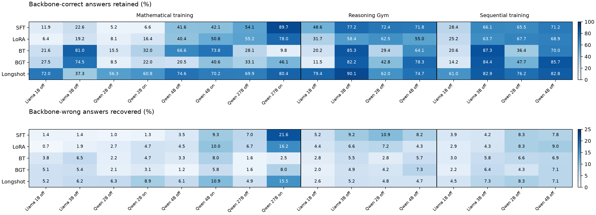

# KOR-Bench correctness overlap

All six appendix tables have two added columns. Diffusion appears only in the separate diffusion appendix; its analysis is in [diffusion.md](diffusion.md). All original accuracy and token entries are preserved.

## Definitions

For the same question, let B indicate that the pretrained instruct backbone was correct and F that the adapted model was correct. Retained = 100 × count(B and F) / count(B). Recovered = 100 × count(not B and F) / count(not B). Baselines compared with themselves therefore have 100% retained and 0% recovered. Thinking off and on are paired separately. Scores pool all 1,250 questions, with the denominator taken over the backbone's correct or incorrect subset, rather than averaging category percentages.

The complete paired contingency table is retained: both correct, backbone only correct (lost), adapted only correct (gained), and both wrong. Correctness changed = 100 × (lost + gained) / 1,250, while accuracy change = 100 × (gained − lost) / 1,250. If p is backbone accuracy and r and g are retained and recovered fractions, adapted accuracy is p r + (1 − p) g. Thus high retention and low recovery indicate closeness in correctness; high recovery alone does not imply better overall accuracy.

## Main-method comparison

These are equal-weight means across eight backbone/thinking conditions for mathematical training and four thinking-off backbones for each other regime. They are descriptive summaries of the available runs, not repeated independent trials or evidence of statistical significance. The mathematical conditions comprise Llama 1B/3B off and Qwen 2B/4B/27B off/on; the other regimes comprise Llama 1B/3B and Qwen 2B/4B off. Compare methods within a regime; the mathematical aggregate has a different model/mode composition.

| Training | Method | Retained (%) | Recovered (%) | Correctness changed (%) | Accuracy change (pp) |
|---|---|---:|---:|---:|---:|
| Mathematical | SFT | 34.21 | 5.82 | 30.86 | -26.06 |
| Mathematical | LoRA | 34.32 | 5.92 | 30.91 | -25.79 |
| Mathematical | BT | 41.05 | 4.06 | 30.47 | -26.05 |
| Mathematical | BGT | 34.11 | 4.03 | 34.08 | -29.74 |
| Mathematical | Longshot | 65.18 | 8.01 | 19.79 | -11.83 |
| Reasoning Gym | SFT | 67.50 | 8.38 | 16.50 | -6.74 |
| Reasoning Gym | LoRA | 51.90 | 5.60 | 21.00 | -14.24 |
| Reasoning Gym | BT | 49.74 | 4.22 | 20.78 | -15.90 |
| Reasoning Gym | BGT | 53.70 | 4.62 | 17.78 | -12.74 |
| Reasoning Gym | Longshot | 76.56 | 4.31 | 12.46 | -7.46 |
| Sequential | SFT | 57.80 | 6.04 | 17.70 | -10.94 |
| Sequential | LoRA | 56.40 | 6.14 | 18.06 | -11.42 |
| Sequential | BT | 53.59 | 5.56 | 19.58 | -13.30 |
| Sequential | BGT | 57.98 | 5.01 | 16.08 | -10.48 |
| Sequential | Longshot | 75.72 | 6.82 | 12.46 | -4.54 |



- Longshot has the highest mean retention and the smallest mean correctness-change rate in all three training regimes. It has the highest retention in 9 of the 16 individual backbone/regime/mode conditions. The exceptions matter: BT leads for mathematical Llama 3B and Qwen 4B thinking-on, SFT for mathematical Qwen 27B thinking-on and Reasoning Gym Qwen 2B, and BGT for Qwen 4B after Reasoning Gym or sequential training. BT also leads for sequential Llama 3B.
- Divergence is usually dominated by lost successes: gained answers exceed lost answers in only 2 of the 80 main-method comparisons. Mathematical Qwen 27B SFT with thinking on retains 694/774 = 89.66% of backbone successes and recovers 103/476 = 21.64% of its errors. It loses 80 successes but gains 103, improving accuracy by 1.84 points. Reasoning Gym Llama 3B Longshot loses 41 and gains 43, a 0.16-point improvement. These small net improvements are descriptive, without a significance claim.
- Similar accuracy can hide considerable turnover. Mathematical Llama 1B Longshot scores 16.88% versus the backbone's 17.44%, yet loses 61 correct answers and gains 54. It preserves only 72.02% of backbone successes, and correctness changes on 115/1,250 = 9.20% of questions. After Reasoning Gym, Llama 3B Longshot has almost unchanged accuracy (33.44% versus 33.28%), with correctness changing on 84/1,250 = 6.72% of questions.
- The affected categories differ markedly. Mathematical Llama 3B Longshot retains only 7.43% of the backbone's counterfactual successes, losing 187 and gaining 1 in that category. Mathematical Qwen 2B Longshot retains 95.98% of counterfactual successes but only 12.21% of operation successes (187 lost and 7 gained). A single aggregate retention percentage conceals these differences; see `categories.csv`.
- Formatting failures explain part, but not most, of the lost successes. Across main-method comparisons, missing/empty answer delimiters occur in 28.46% of lost-success events after mathematical training, 26.46% after Reasoning Gym, and 25.39% after sequential training. These are pooled run-question events, not unique questions. The benchmark's parse-failure flag is narrower than all possible grading or answer-format problems.

Restricting mathematical training to the same four thinking-off backbones used in the other regimes gives Longshot 60.05% retained and 5.96% recovered, versus retention of 20.32% for SFT, 18.54% for LoRA, 46.17% for BT, and 32.76% for BGT. Its mean-retention lead therefore also holds in this matched subset.

## Coverage and interpretation

The audit covers 104 distinct complete evaluations (130,000 saved responses), reproducing every category accuracy and overall accuracy in all 144 reported table/mode entries. Repeated baseline and Longshot rows across the appendices are counted only once per comparison condition. There are 96 adapted-model comparisons (80 main methods and 16 diffusion), each paired on all 1,250 questions. Question identities and complete source documents match exactly. No model generation or training was rerun.

Some Llama comparisons have different `Today Date` strings in the system prompt: mathematical Llama 1B BT, BGT, and diffusion, and both Llama backbones after Reasoning Gym or sequential adaptation. All prompts match after replacing that date field, checked on every question. These differences are a confound for attributing changes solely to training. All other paired prompts match exactly. Thinking mode, chat formatting, generation caps, source data, and scoring identity were also checked.

These metrics describe overlap of correctness, not semantic equivalence of wrong answers, similarity of reasoning traces, internal representations, or distributional divergence. The `both_wrong` group may contain different wrong answers. `summary.csv` additionally records exact response-string agreement and exact nonempty extracted-answer agreement over all questions; these are literal equality measures, not semantic judgments. Category-specific denominators can be small, so consult counts alongside percentages. The experiments use one available training seed per condition and do not support a universal ranking of adaptation methods.

## Reproduction and files

Run from the repository root with the existing evaluation environment:

```bash
OPENBLAS_NUM_THREADS=1 .venv/bin/python data/analysis/korbench_overlap/analyze.py
.venv/bin/python data/analysis/korbench_overlap/update_tables.py
MPLCONFIGDIR=/tmp/gcw-overlap-mpl .venv/bin/python data/analysis/korbench_overlap/report.py
```

`analyze.py` uses the existing KOR-Bench scorer to rescore eight historical Qwen 27B evaluation files offline, bringing them to the same scoring convention as the paper. All other runs use their recorded per-example scores. Raw source files are unchanged. `provenance.json` records source paths, SHA256 hashes, original and effective scoring metadata, score-change counts, and the mapping to paper rows. The three complete original 27B thinking-on backbone/SFT/LoRA files were copied read-only from `nb_gpu:/opt/soperator-home/martin/global-cache-workspace/results/qwen27b-korbench-concurrent-20260920_162752/` into `data/analysis/local/korbench-overlap-20260924/sources/`; their names and hashes are in the manifest. Other raw files remain at their existing local/shared-storage paths. Reproduction requires those saved results and the evaluation dependencies.

- `summary.csv`: paired counts and percentages for each regime/backbone/method/mode, including self-comparisons for baselines.
- `categories.csv`: the same contingency analysis for each KOR-Bench category.
- `paired_correctness.csv.gz`: source-question identities and paired binary correctness, sufficient to recompute all contingency statistics without model files or scoring dependencies.
- `provenance.json`: source and paper-row audit trail.
- `overlap.png` / `overlap.pdf`: main-method condition-level heatmaps.
- `diffusion.md` and `diffusion_overlap.png` / `.pdf`: separate diffusion comparisons.

`update_tables.py` inserts the two columns only into KOR-Bench tables and leaves a table unchanged if it already contains them. Existing unavailable thinking modes remain unavailable. The original accuracy and response-token columns are preserved.

## Validation

Independent recomputation from the compressed paired labels confirms every contingency count and conditional percentage. All 117 expanded KOR-Bench table rows preserve their original accuracy and token entries; all other tables are unchanged. The existing paper-figure parser accepts both updated appendices. The complete paper, including the diffusion archive, compiled successfully with the cached Tectonic toolchain, and the rendered table pages were checked. The build retains the pre-existing bibliography and underfull-box warnings. Analysis scripts pass Ruff checks, table updates are idempotent, and both repository diffs pass whitespace checks.
