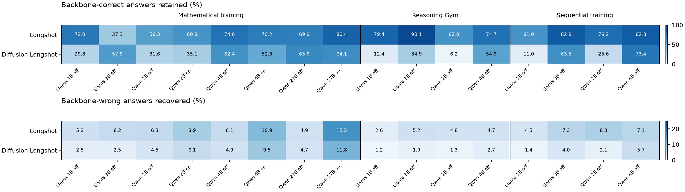

# Separate diffusion overlap analysis

Diffusion results were added only to the three KOR-Bench tables in `E_Diffusion_Archive.tex`. A [separate follow-up](diffusion_normalization.md) accounts for accuracy using success composition and category-normalized overlap; the raw comparisons below alone do not establish greater behavioral divergence. Definitions, provenance, and limitations are shared with [the main report](README.md). Means below give equal weight to the eight mathematical backbone/thinking conditions and the four conditions in each other training regime.

| Training | Method | Retained (%) | Recovered (%) | Correctness changed (%) | Accuracy change (pp) |
|---|---|---:|---:|---:|---:|
| Mathematical | Longshot | 65.18 | 8.01 | 19.79 | -11.83 |
| Mathematical | Diffusion Longshot | 49.88 | 5.80 | 25.08 | -19.62 |
| Reasoning Gym | Longshot | 76.56 | 4.31 | 12.46 | -7.46 |
| Reasoning Gym | Diffusion Longshot | 27.08 | 1.77 | 27.96 | -25.96 |
| Sequential | Longshot | 75.72 | 6.82 | 12.46 | -4.54 |
| Sequential | Diffusion Longshot | 43.36 | 3.28 | 21.36 | -17.80 |

Diffusion retains fewer pretrained successes than Longshot in 15 of 16 conditions. The exception is mathematical Llama 3B: diffusion retains 241/416 = 57.93%, versus Longshot's 155/416 = 37.26%, while recovering 21/834 = 2.52% versus 52/834 = 6.24%. Diffusion has lower mean recovery and greater mean correctness turnover in every regime. In all 16 diffusion conditions, lost successes exceed recovered errors.

The strongest separation is after direct Reasoning Gym adaptation: mean retention is 27.08% for diffusion versus 76.56% for Longshot, with mean recovery of 1.77% versus 4.31%. These results characterize the recorded checkpoints and evaluation settings, including the Llama system-date differences described in the main report.

The Qwen 27B thinking-on comparison uses the complete 1,250-question backbone evaluation, not the earlier partial recovery snapshot. Diffusion retains 496/774 = 64.08% and recovers 56/476 = 11.76%; it loses 278 successes and gains 56, for a 17.76-point accuracy decline.
