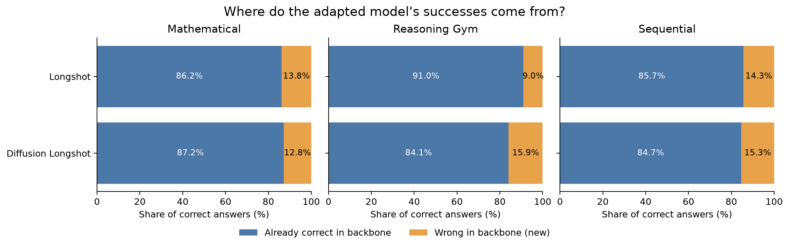
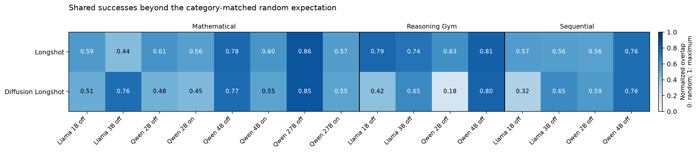

# Separate diffusion analysis after accounting for accuracy

Definitions and a worked example are in [the main normalization analysis](normalization.md). This comparison uses the same saved evaluations as the [original diffusion analysis](diffusion.md). It changes no paper tables.

Means give equal weight to eight backbone/thinking conditions after mathematical training and four thinking-off conditions in each other training regime. Shared and new success shares sum to 100%; category-normalized overlap is a dimensionless score.

| Training | Method | Shared successes (%) | New successes (%) | Category-normalized overlap |
|---|---|---:|---:|---:|
| Mathematical | Longshot | 86.22 | 13.78 | 0.626 |
| Mathematical | Diffusion Longshot | 87.19 | 12.81 | 0.615 |
| Reasoning Gym | Longshot | 91.03 | 8.97 | 0.741 |
| Reasoning Gym | Diffusion Longshot | 84.07 | 15.93 | 0.514 |
| Sequential | Longshot | 85.68 | 14.32 | 0.614 |
| Sequential | Diffusion Longshot | 84.66 | 15.34 | 0.579 |

Accounting for accuracy substantially weakens the raw-retention contrast after mathematical training: category-normalized overlap is 0.615 for diffusion and 0.626 for Longshot, while new-success shares are 12.82% and 13.78%, respectively. Diffusion's successes are therefore not generally more novel simply because its raw retention is lower. After Reasoning Gym the normalized gap remains large (0.514 versus 0.741); after sequential training it is smaller (0.579 versus 0.614). The two normalizations need not rank methods identically because one describes success composition and the other also conditions on category accuracies.

These are descriptive results, without significance tests. Single-seed coverage, shared question difficulty, and the documented Llama system-date differences remain limitations. All numeric inputs and derived quantities are in `normalization.csv`; regeneration uses `normalize.py` as described in the main report.
