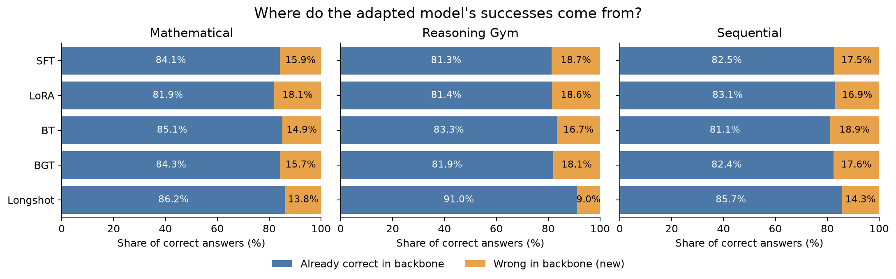
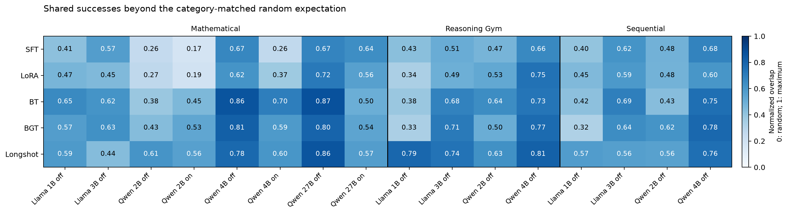

# Retention and recovery after accounting for accuracy

This follow-up qualifies the [original analysis](README.md): Longshot's higher raw retention establishes that it preserves more backbone successes, but does not by itself establish greater similarity independently of overall accuracy. A model with more correct answers can have both more retained successes and more recovered errors. This analysis uses the existing paired counts; it changes no paper tables. Diffusion comparisons are [reported separately](diffusion_normalization.md).

## First measure: where do the adapted model's successes come from?

Take only the questions that the adapted model got right. What percentage did the backbone also get right, and what percentage did the backbone get wrong?

- Shared-success share = 100 × both correct / adapted correct.
- New-success share = 100 × adapted correct but backbone wrong / adapted correct.

These percentages add to 100. Their denominator is the adapted model's successes. The original Retained column divides by the backbone's successes; the original Recovered column divides by the backbone's errors. Thus new-success share and Recovered answer different questions. “New” denotes a success relative to the backbone on this question, not evidence of a new reasoning mechanism.

For mathematical Qwen 4B with thinking disabled:

| Method | Adapted successes | Shared with backbone | New successes | Original retention | Shared-success share | New-success share |
|---|---:|---:|---:|---:|---:|---:|
| BT | 522 | 506 | 16 | 66.58% | 96.93% | 3.07% |
| Longshot | 597 | 567 | 30 | 74.61% | 94.97% | 5.03% |

Longshot preserves more successes overall, while BT's successes are more concentrated on questions already solved by the backbone. Neither description contradicts the other. A larger new-success share indicates greater complementarity among successful answers; it does not imply higher accuracy or greater total recovery.



Bars are equal-weight means of per-condition percentages, not percentages obtained by pooling every run's answers. Mathematical training has eight conditions (Llama 1B/3B off; Qwen 2B/4B/27B off/on); Reasoning Gym and sequential training each have four (Llama 1B/3B and Qwen 2B/4B off). Compare methods within a training regime. Shares can be unstable when a method has few successes. Across backbones, the available fraction of backbone-wrong questions also changes. With independently allocated successes, expected new-success share equals the backbone's error rate, rather than zero.

## Second measure: does the overlap exceed what the scores already predict?

Imagine shuffling the adapted model's correct/incorrect labels among questions within each KOR-Bench category. Keep the backbone's answers fixed. The adapted model keeps exactly the same number of correct answers in every category; only the identities of its successful questions change. This is a reference calculation, not a simulation of model behavior or a new evaluation.

The measure asks how far the real overlap lies between the overlap expected after this shuffle and the largest overlap possible with those same scores.

### A small worked example

Suppose one category contains 100 questions. The backbone gets 60 right and the adapted model gets 40 right. Of those 40 successes, 30 are shared with the backbone and 10 are new.

1. Randomly placing 40 successes among 100 questions would put 60% of them in the backbone's successful set. Expected shared successes: 40 × 0.60 = 24.
2. The most shared successes possible is 40, since all 40 adapted successes could fit inside the backbone's 60 successes.
3. The observed 30 shared successes are 6 above the expectation, out of a possible excess of 16. The normalized score is (30 − 24) / (40 − 24) = 0.375.

This means the overlap is 37.5% of the way from the random expectation to the maximum feasible overlap. It does **not** mean 37.5% of backbone answers were retained: ordinary retention here is 30/60 = 50%, and new-success share is 10/40 = 25%.

For multiple categories, add each category's expected overlap and maximum overlap before normalizing. If category c contains n_c questions, b_c backbone successes and f_c adapted successes, and O is the observed total of shared successes:

```text
E = sum_c (b_c * f_c / n_c)       expected shared successes
U = sum_c min(b_c, f_c)           maximum feasible shared successes
S = (O - E) / (U - E)            category-normalized overlap
```

S = 1 means the largest possible overlap at the observed category accuracies. S = 0 means overlap equal to the category-matched random expectation. Negative values are possible and mean less overlap than expected; the negative range need not stop at −1. If U = E, there is no overlap freedom under this normalization and S is undefined. Every reported comparison here has U > E and positive S. The heatmaps therefore use a shared 0–1 color scale. This is a proposed descriptive normalization, not a significance test or a claim of an established metric name.

The category adjustment matters because two models may overlap simply because both do well on counterfactual questions and poorly on puzzles. It holds those category accuracies fixed, while still allowing shared question difficulty within categories to explain some overlap.



## Results and revised interpretation

The two success shares below are percentages; the final column is a dimensionless score. All entries are equal-weight means of per-condition values, with the same condition sets as the first plot.

| Training | Method | Shared successes (%) | New successes (%) | Category-normalized overlap |
|---|---|---:|---:|---:|
| Mathematical | SFT | 84.14 | 15.86 | 0.457 |
| Mathematical | LoRA | 81.85 | 18.15 | 0.455 |
| Mathematical | BT | 85.12 | 14.88 | 0.630 |
| Mathematical | BGT | 84.33 | 15.67 | 0.614 |
| Mathematical | Longshot | 86.22 | 13.78 | 0.626 |
| Reasoning Gym | SFT | 81.31 | 18.69 | 0.516 |
| Reasoning Gym | LoRA | 81.39 | 18.61 | 0.525 |
| Reasoning Gym | BT | 83.33 | 16.67 | 0.611 |
| Reasoning Gym | BGT | 81.95 | 18.05 | 0.580 |
| Reasoning Gym | Longshot | 91.03 | 8.97 | 0.741 |
| Sequential | SFT | 82.51 | 17.49 | 0.544 |
| Sequential | LoRA | 83.12 | 16.88 | 0.530 |
| Sequential | BT | 81.07 | 18.93 | 0.575 |
| Sequential | BGT | 82.42 | 17.58 | 0.591 |
| Sequential | Longshot | 85.68 | 14.32 | 0.614 |

- After mathematical training, category-normalized overlap is essentially tied between BT (0.630) and Longshot (0.626), with BGT close behind (0.614). The raw-retention lead does not establish a clear normalized lead for Longshot here.
- After Reasoning Gym, Longshot's normalized overlap remains higher (0.741 versus 0.611 for the next-highest method, BT). Only 8.97% of its successful answers are new relative to the backbone, versus 16.67–18.69% for the other methods. This supports stronger concentration on backbone successes in the recorded runs.
- After sequential training, Longshot's normalized lead is modest (0.614 versus 0.591 for BGT). Its mean new-success share is 14.32%, versus 16.88–18.93% for the other methods.

Raw retained and recovered rates remain useful measures of absolute preservation and recovery. The new measures describe how the available successes are distributed. At fixed backbone accuracy p and adapted accuracy q, retention r and recovery g obey q = p r + (1 − p) g. Consequently, after fixing performance, greater retention necessarily trades off against recovery; they cannot be treated as independent abilities. The second measure also accounts for successes that must be new whenever adapted accuracy in a category exceeds backbone accuracy.

No normalization completely isolates preservation of internal model behavior. The shared-difficulty explanation, system-date differences in some Llama comparisons, single-seed coverage, and possible answer-format effects still apply. The first measure remains constrained by the two accuracies, and the second depends on the chosen category-based reference. Stronger follow-up checks would hold accuracy fixed within individual rules and estimate uncertainty by resampling rules. Neither is performed here, and no statistical-significance claim is made. Diffusion has its own comparison rather than being included in the main-method ranking.

## Reproduction

From the repository root:

```bash
MPLCONFIGDIR=/tmp/gcw-overlap-mpl OPENBLAS_NUM_THREADS=1 .venv/bin/python data/analysis/korbench_overlap/normalize.py
```

This reads `summary.csv` and `categories.csv`, validates that category contingency counts sum to the corresponding overall counts, and writes `normalization.csv`, this report, the separate diffusion report, and both pairs of PNG/PDF plots. `normalization.csv` contains all 112 comparison conditions, including baseline self-comparisons, and exposes the success counts, both success shares, expected overlap, minimum/maximum feasible overlap, and normalized overlap. The plots exclude baseline self-comparisons. Empty CSV metric cells indicate an undefined denominator. Original score and sample provenance is in `provenance.json`; no raw results or model execution are needed for this follow-up.
